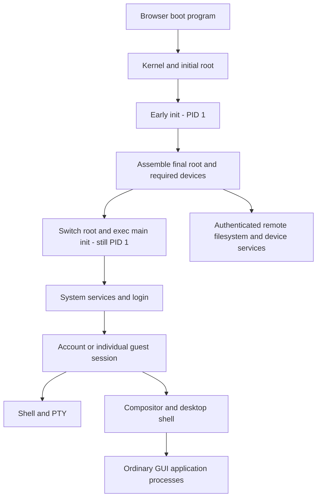
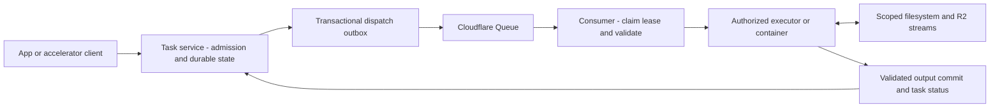

# OS

A browser-hosted OS with WASI/WASIX processes, a filesystem, accounts, Unix-style permissions, a terminal, and desktop applications. The target architecture is a client OS kernel with its own boot/init/session lifecycle and provider-independent contracts for remote storage, identity, relay and device services. Cloudflare is the first backend. Instances cooperate through shared resources and explicit tasks; archive/media accelerators already keep bulk work near cloud storage. The browser supplies the execution environment and loads the boot program. The current implementation still delegates process registration and system filesystem operations to Durable Objects and renders built-in apps through Rust/Leptos and the DOM. The [client OS architecture](#client-os-and-remote-services) defines the intended boundaries and the remaining migration. The Cloudflare deployment uses `wrangler.toml`.

For maintainers and incoming agents, start with [AGENT.md](AGENT.md).

## Project naming and legacy configuration

The project is **OS**, hosted at [kingwingfly/os](https://github.com/kingwingfly/os). Packages use `os` and `os-*`; browser APIs use `window.os`; program extensions use the `os` WASM import namespace. The desktop's Terminal remains a terminal emulator, with ordinary terminal/PTY names.

`wrangler.toml` describes the `os` installation with `os-files` storage and `OsAuthority`. `wrangler.legacy.toml` still exists for an installation made under the earlier product name: it keeps the original service, R2 bucket and Durable Object identities while running the OS code. It is not required any more: the #44 refactor keeps no compatibility with previous versions, and after it the owner removes the deployment and its data and redeploys with `wrangler.toml` ([architecture contract](docs/architecture/contract.md) §2.12). This build requires database schema 7 and refuses older schemas; no SQL migration upgrades them.

The remaining legacy product identifiers exist only for that earlier installation and may be removed during #44: the old Durable Object export, R2 ownership marker and frontend content ID, migration of session/guest cookies and saved browser preferences, and acceptance of the old `terminal` WASM import namespace for existing uploaded programs. New cookies use `os_session`/`os_guest`; a successful login/logout overrides migration, and old cookies are expired so logout cannot restore an earlier login. New preferences take precedence when both names exist.

## Local development

Prerequisites: Node.js, Rust with the `wasm32-unknown-unknown` and `wasm32-wasip1` targets (the second for uutils' coreutils, in /usr/bin), `worker-build 0.8.5`, `wasm-bindgen-cli 0.2.129`, and clang with its WebAssembly target plus `llvm-ar`, which compile the tree-sitter grammars of the code previews. The wasm-bindgen CLI must match the Rust dependency version in `Cargo.lock`. The installed shell builder also needs `tar`, POSIX `sh` and standard text tools; it downloads checksum-pinned WASI SDK/WASIX libc archives into `~/.cache/os/build` (`OS_BUILD_CACHE` overrides this). Its SDK supports Linux/macOS x86_64 and ARM64; Linux x86_64 is the validated build host. Archive jobs (`zip`, `unzip`, `tar`) run in a container, which needs Docker or Podman; see [Archives](#archives).

```bash
rustup target add wasm32-unknown-unknown wasm32-wasip1
cargo install worker-build --version 0.8.5 --locked
cargo install wasm-bindgen-cli --version 0.2.129 --locked
npm ci
npm run setup
npm run build:web
npm run dev
```

In another terminal:

```bash
npm run seed
```

Open **http://127.0.0.1:8787**. `npm run dev` and direct `wrangler dev` both use port 8787, the one configured in `wrangler.toml`. Local development requires no Cloudflare login or account access.

`setup` creates `.dev.vars` and `.local-password` only when credentials do not exist. Both are gitignored. `ADMIN_PASSWORD` bootstraps root only during the first database initialization; later changes use `passwd`. Changing `.dev.vars` does not reset an existing root password. `SESSION_SECRET` is a password-hash pepper: preserve it when restoring data.

`npm run dev` runs `scripts/dev.mjs`, which starts `wrangler dev` with its arguments. Where Docker is missing and Podman present, it starts a private Podman API service for the session (`scripts/podman.mjs`, shared with the conformance harness) and points wrangler at it, through `scripts/podman-docker.sh` (a shim for the Docker flags Podman's builder lacks) and `scripts/engine-proxy.mjs` (which removes the memory swappiness workerd asks for in every container; crun refuses it on cgroup v2 wherever cgroups apply, as in a systemd user session: `cannot set memory swappiness with cgroupv2`), with cgroups managed by Podman itself when there is no systemd user session. Each session has its own service and socket; none borrows another's. Wrangler is started from its own entry point rather than through `npx`, so signals and exit status are Wrangler's. Podman runs in its own process group: Ctrl-C, SIGTERM or a closed terminal (SIGHUP) reach npm, dev and wrangler but not Podman, so wrangler can still remove its containers, and Podman stops after wrangler exits. Under `npm run`, one Ctrl-C reaches dev twice (from the terminal and relayed by npm); an identical signal within half a second counts once, and a later one exits at once. The service also stops if dev is killed outright, because it watches a pipe that dev holds open; it gets SIGTERM, then SIGKILL after five seconds. A session's socket directory under `$TMPDIR` records its owner, and the next session removes directories whose owner has died. If Podman cannot start, wrangler starts without containers; if it is still starting after ten seconds, wrangler starts anyway and dev reports whether Podman later came up. If Miniflare's egress image cannot be determined, only that override is skipped. Rootless Podman needs subordinate ID ranges for your user in `/etc/subuid` and `/etc/subgid` (for example `sudo usermod --add-subuids 165536-231071 --add-subgids 165536-231071 $USER`, then `podman system migrate`). The first start builds the job container's image, pulling `rust:1-alpine`; later starts reuse it. With Podman, start through `npm run dev`, not `npx wrangler dev`: wrangler alone, even with `WRANGLER_DOCKER_BIN=podman`, passes `podman build` flags it rejects (`unknown flag: --provenance`) and finds no Docker socket. To pass wrangler options, add them after `--`, as in `npm run dev -- --persist-to /tmp/state`.

`npm run deploy` deploys: it runs the full build (`scripts/build.mjs`, the page in `dist/`), then `wrangler deploy`, which builds the Worker and the job container's image, through `scripts/podman-docker.sh` where Docker is missing and Podman present. `wrangler deploy` alone builds only the Worker, as `[build]` in `wrangler.toml` is what `wrangler dev` reruns on every Worker or core change, and uploads `dist/` as it is, stale or not. Options after `--` go to wrangler, as in `npm run deploy -- --dry-run`. The secrets come first, once: `npx wrangler secret put` for `ADMIN_PASSWORD`, `SESSION_SECRET`, and, for live sound, `REALTIME_APP_ID` and `REALTIME_APP_TOKEN`.

Rebuild frontend changes with `npm run build:web` (currently `npm run build` builds the same frontend). Wrangler watches Worker/core Rust sources. If newly generated lazy chunks return 404, restart your local Wrangler process after the build. Avoid concurrent Worker builds into the same `crates/worker/build` directory.

`seed` is local-only, defaults to port 8787, and preserves existing files. It installs `welcome.md`, `readme.txt`, `demo.slides.md`, and a generated `media/signal.wav`. Use `OS_PORT` to select another local instance. After changing root's password, supply the current password through `OS_PASSWORD` rather than changing the bootstrap secret.

## Accounts and permissions

Signed-out browsers receive their own `guest-<uuid>` identity (uid 1,000,000–1,999,999), in group `guest` (gid 65534). The reserved uid 65534 is the fallback guest. These identities cannot sign in, as `nobody` cannot on Linux. The server checks permissions on every request, as Linux does: an owner by the owner bits, a named user by its ACL entry, members of the owning or a named group by those entries (any may allow), everyone else by the other bits. Classes do not combine: an owner uses owner bits even if other bits are more permissive. Root (uid 0) retains full control.

| Operation | Required permissions |
| --- | --- |
| Read, download, HEAD, Range | File r; every ancestor directory x |
| List a directory | Directory r+x; ancestors x |
| Enter a directory | Directory and ancestors x; without r its listing is unavailable |
| Create a file/directory | Parent w+x |
| Delete a file | Parent w+x, independent of the file write bit |
| Recursively delete a directory | Parent w+x and every emptied directory r+w+x; validate the whole tree first |
| Overwrite a file | File w; ancestors x |
| Remove or rename in a sticky directory (`+t`) | Also be the entry's owner, the directory's owner, or root |
| chmod, setfacl | Owner or root |
| chown, chgrp | Root can change owner/group; ordinary owners can select only a group they belong to |
| Hard link (`ln`) | Directory w+x; without root, own the file or may read and write it (protected_hardlinks) |
| Follow a symbolic link in a sticky directory others may write | Own the link, or the directory's owner does (protected_symlinks) |
| `user.*` attributes (setfattr) | File w; on a sticky directory, its owner |

Every request is checked when it is made, reads by path included: a `chmod`, `chown`, `setfacl`, removal or sign-out refuses the next one at once. What reads a file in many ranges reads it by a token instead: `open` of a whole file for reading gives one, the player plays from `GET /api/file?token=` (and /usr/bin's programs read large files so), and the Worker takes the kernel's word for a minute, so that a video's ranges do not each ask it. The kernel asks again then whether the descriptor is still open, still its session's, and its account may still read the file: a change of permission, a `close` or signing out stops such a read within a minute. A token is its session's; any other's request with it is refused.

Defaults are files 644, directories 755, and user homes 700. Public files inside private homes also need traversable ancestors; for example, home 711 and file 644 allow reading a known path without listing the home. Use 755 to permit listing.

The executable bit controls execution in the OS runtime; it does not launch programs in the host operating system. Processes start with umask 022 and can change their own creation mask through the supported POSIX adapter. Omitted chmod classes apply to all three classes.

- **Links.** Paths name inodes. A hard link (`ln`) is another name for an inode: content, owner, mode, ACLs and attributes are shared, and the inode goes with its last name; directories cannot be hard-linked. A symbolic link (`ln -s`) holds a target path, relative to its directory or absolute, which may not exist; its mode is always 777. Every path is resolved as the kernel resolves one: each link on the way is followed with the caller's search permission checked at every directory, at most 40 links per path. Commands follow a link at the end of a path except those that act on names (`rm`, `mv`, `ln`, `readlink`, `mkdir`, `chown -h`, `ls -l`/`-d`). `..` is resolved in the path as typed, as the shell's `cd` does, so `cd link` then `cd ..` comes back.
- **Special bits.** setgid on a directory gives what is made in it the directory's group, and the bit to new directories; sticky (`+t`) lets only an entry's owner, the directory's owner or root remove or rename it. setuid is kept and shown. Without root, setgid needs the file's group to be one of the caller's. Changing a file's owner clears setuid, and setgid if the group may execute it.
- **ACLs.** `setfacl` adds named user and group entries; the mode's group bits are then the mask, which bounds them, so `chmod` changes the mask. A directory's default ACL is what is made in it gets, in place of the umask. `ls -l` marks an ACL with `+`; `getfacl` shows `#effective` rights.
- **Extended attributes.** `setfattr`/`getfattr` keep `user.*` attributes (read to get, write to set) and root's `trusted.*`, up to 4 KB per inode.

### Identity changes and sudo

- `su [-] [USER]` switches this browser session (default root). Ordinary users supply the target password; root can switch to an enabled account without it. `-` enters the target home.
- `login [USER]` opens a username/password dialog and enters the account home.
- `sudo COMMAND` elevates only that command and leaves the current identity unchanged. Ordinary accounts must belong to **wheel**. guest cannot sudo. Verify the caller's own password; authorization lasts five minutes, and membership is rechecked for each request. `sudo -k` revokes it.
- `sudo -u USER` intentionally switches the browser account and enters its home. This is this terminal's simplified behavior, not Linux run-as syntax; no trailing command is accepted.
- `exit` and `logout` revoke the session and return directly to guest at `/`; there is no account stack.
- Permission failures never implicitly sign in as root. Browser interactions such as open, vim, and upload use the current identity.

Root and system groups are protected from deletion; root's identity fields are fixed.

### Example workflow

```text
su root
groupadd research
useradd -m -d /home/alice -G research alice
passwd alice
mkdir /shared
chown root:research /shared
chmod 770 /shared
usermod -aG wheel alice
su - alice
touch notes.md
vim notes.md
sudo chmod o+r /shared/result.md
sudo -k
exit
```

Create `/shared/result.md` before the example chmod. All passwords are entered in dialogs, not in command history.

### Command reference

Browser commands generate help and manual pages from their clap definitions (`crates/core/src/cli`). External programs own their options and help: use `ls --help` or `help ls`; `ls -h` means human-readable sizes. A wrong argument gets one line saying what was wrong, such as `rm: missing PATH...; rm -h shows how to use it`. Help runs before authentication or side effects, including `sudo chmod -h`. `--` terminates help/option interpretation where supported, as in `rm -- -h`.

| Command | Implemented syntax |
| --- | --- |
| Files | `ls [-l] [-a] [-d] [-t\|-S] [-r] [PATH]`, `stat [-L] [-c FORMAT\|--printf FORMAT] FILE...`, `df [-h] [FILE...]`, `cd [PATH/~]`, `pwd`, `open FILE`, `upload [DIR]` |
| Create/remove | `mkdir [-p] PATH...`, `rmdir [-p] DIR...`, `touch [-c] [-a] [-m] [-h] [-d DATE\|-t STAMP\|-r FILE] [--] FILE...`, `rm [-r] [-f] [--] PATH...` |
| Links | `ln [-s] [-f] [-n] [-L\|-P] [-v] TARGET... [LINK]`, `readlink [-f\|-e\|-m] [-n] FILE...`, `realpath [-e\|-m] FILE...` |
| Move/copy | `mv [-f\|-n\|-i] [-v] SOURCE... DEST`, `cp [-r] [-f\|-n\|-i] [-v] SOURCE... DEST` |
| Find | `fd [-H] [-t f\|d\|x] [-e EXT] [-d N] [-g\|-F] [-i\|-s] [-p] [-a] [-0] [PATTERN] [PATH...] [-x\|-X COMMAND...]` |
| Text | `echo`, `cat`, `head`, `tail`, `grep`, `wc`, `sort`, `uniq`, `xargs`, joined by `\|` |
| Permissions | `chmod [-R] MODE PATH...`, `chown [-R] [-h] USER[:GROUP] PATH...`, `chgrp [-R] [-h] GROUP PATH...`, `getfacl`, `setfacl`, `getfattr`, `setfattr` |
| Accounts | `useradd [-m\|-M] [-d HOME] [-g GROUP] [-G G1,G2] USER`; signed out, `useradd [-m\|-M] [--short-password] NAME` |
| Update account | `usermod [-a] [-G G1,G2] [-g GROUP] [-d HOME [-m]] [-l NEW] [-L\|-U] USER` |
| Remove account | `userdel [-r] USER`; an account in group guest, itself |
| Groups | `groupadd GROUP`, `groupmod -n NEW OLD`, `groupdel GROUP` |
| Password | `passwd [--force] [USER]` |
| Identity | `whoami`, `id [-u|-g|-G] [-n] [-r] [USER]`, `groups [USER]`, root-only `users` |
| Interface | `help`, `man [COMMAND]`, `clear`, `vim FILE` |
| /usr/bin (uutils) | `cut`, `tr`, `seq`, `printf`, `date`, `tee`, `truncate`, `split`, `od`, `base64`, `sha256sum`…, and `/usr/bin/NAME`, `coreutils NAME`, `syscall CALLS` |

Signed out, `useradd NAME` makes an account of one's own: the dialog asks for its password (12 characters unless `--short-password`), and the browser is signed in. The account has a private primary group and is in group `guest`; its home is `/guest/NAME`, mode 700, which `-m` makes (and `-M`, the default, does not), as useradd does. Other options need sudo. `/guest` is `root:guest` 1777, shared and sticky like `/tmp`. Registration is rate-limited per address, and guests may make at most 1,000 accounts. `guest` itself cannot have a password, be changed, or be deleted.

An account in group `guest` deletes itself: signed in as NAME, `userdel NAME` (with `-r`, its home too, if it is a directory of its own) asks for its password in the dialog, ends its sessions and returns the browser to guest. Root deletes any account; other accounts need it. As Linux userdel does, the account's group of the same name goes with it unless another account is in it, and `-r` keeps a home that is not the account's. A home not made yet is its account's to make: no one else may take its path, as anyone could in `/guest`.

An account sends at most three live sounds at once; starting one is rate-limited, as each makes a Realtime session.

As root, `useradd -m` creates the home; `-d` selects its absolute path. Without `-g`, a same-name primary group is created. New accounts need `passwd USER` before login. Names start with a lowercase letter and contain up to 32 lowercase letters, digits, underscores, or hyphens.

`usermod -G` replaces supplementary memberships; `-aG` appends. `-d PATH -m` atomically moves the home mapping while preserving content keys and permissions, without copying large files. The target must not exist or overlap another home. Without `-m`, only the account home field changes. `-g` changes the primary group, not existing file groups. `-L` locks and revokes sessions; `-U` does not restore those sessions.

`passwd` defaults to at least 12 characters and at most 512 bytes. `--force` explicitly permits short, nonempty passwords without bypassing identity or authorization checks. Ordinary users must supply their current password and can change only their own; root or sudo can reset others. Password changes revoke old sessions; self-service changes issue a replacement session to the current browser. Plaintext `useradd/usermod -p` arguments are not accepted.

Passwords use random salts, PBKDF2-SHA256 (100,000 iterations), and a server-side pepper. Sessions use random opaque tokens and HttpOnly/SameSite=Strict cookies, with Secure on HTTPS and an eight-hour lifetime. Authentication endpoints are rate-limited.

`touch` creates empty files with mode 644 (or what a default ACL gives), including extensionless names; of one that exists, it sets the times (`stat` shows them, in UTC, to the nanosecond), leaving content and mode intact. `-d DATE`, `-t STAMP` and `-r FILE` set another time than now, `-a` and `-m` only one of the two, `-h` a link itself; `-c` skips missing files. Now is the owner's or a writer's to set, another time the owner's, as on Linux. Reading does not change a file's access time: the store is mounted `noatime`. As GNU touch, each operand succeeds or fails on its own. `sudo touch` creates files as root for that command only.

`mkdir`, `rm`, `chmod`, and `chown` accept several paths. As on Linux, each path succeeds or fails on its own: failures are reported, and the others are still done; `rm -r` removes what it may of a tree and says what it may not, leaving the directories that hold it. As GNU's tools, they print nothing on success but with `-v`, and say why they failed as GNU's do (`rm: cannot remove 'x': Permission denied`). `rm` refuses `.` and `..`, and `-r` of `/`. There is no trash.

`mv` and `cp` follow Linux defaults: an existing file at the destination is replaced. `-n` never replaces one; `-i` asks for each. A directory is never replaced. `mv` moves names, so the inode keeps its owner, mode, ACLs and other names, and moving is instant whatever the size; it needs w+x on both parents, and a directory that changes parent needs w itself. A directory that is, or holds, an account's home cannot be moved, as a mount point in use cannot (use `usermod -d HOME -m`).

`cp` follows GNU cp. New nodes belong to the caller, with the source mode less the umask, or what the destination's default ACL gives. An existing file is written in place, keeping its owner, mode and other names (which need w on it). With `-f`, a file that cannot be written is removed and copied anew. `-p` keeps the mode, ACLs, times, and, as far as the caller may, the owner and group. Without `-r`, a link named is followed. With `-r`, links are copied as links, unless `-L` follows them all or `-H` those named. `-d` copies a file's several names as one file; `-a` is `-dpR` plus extended attributes. Copying a file onto another of its names is refused ("the same file"), as is writing through a dangling link. Copies share the source's immutable content, so they are instant too; editing either later keeps the other unchanged. A file still uploading cannot be copied yet.

`fd` follows sharkdp/fd: a regular expression (smart case) matched against names, or against whole paths with `-p`; `-g` for globs and `-F` for fixed strings; dot-names skipped unless `-H`. It searches only what the caller may list, reporting directories it could not read. `-x COMMAND` runs once per result and `-X COMMAND` once with all of them; `{}`, `{/}`, `{//}`, `{.}`, and `{/.}` are placeholders.

### Pipes

`A | B` passes what A writes to B. Commands that read input are the text filters `cat`, `head`, `tail`, `grep` (Rust regular expressions, as with `grep -E`), `wc`, `sort`, and `uniq`, plus `xargs`, which runs a command with the items it reads (`-0`, `-d`, `-n`, `-I`, `-r`, `-t`, and `-o` for terminal input). Consecutive external stages run concurrently through shared pipes when the browser is isolated. Stages involving shell builtins or browser UI actions pass buffered text. A trailing `&` starts an external pipeline as a background job; other shell operators (`&&`, `||`, `;`, `<`, `>`) are refused rather than taken literally; quote them to use them as text. Unquoted wildcards expand as in bash before a stage runs: `*`, `?` and `[...]` (`[a-z]`, `[!x]`) match names in each part of a path (`rm -rf *`, `cat docs/*.md`, `echo */`), sorted by byte order as `ls` sorts here (bash's order under `LC_ALL=C`: `B.md` before `a.md`), listed with the caller's permissions. Names starting with a dot match only a pattern starting with one; quoted or escaped wildcards are literal; a pattern that matches nothing stays as typed. Brace expansion (`{a,b}`) and `**` are not supported; `fd` fills that role. Quoting follows bash: single quotes keep everything as it is; within double quotes a backslash escapes only `$`, `` ` ``, `"`, `\` and a newline, and is kept before anything else (`grep "\d+"` searches for `\d+`); outside quotes it escapes any character.

```text
fd -e md | xargs wc -l
fd -0 -t f . reports | xargs -0 chmod 640
fd -e log -X rm
ls | grep -i draft | sort
```

## Editing and terminal interaction

`vim FILE` opens a floating CodeMirror editor with ordinary editing shortcuts, not Vim modes. Markdown, Rust, Python, JS/TS, JSON, HTML/CSS, C/C++, TOML, YAML, and shell have syntax highlighting. Use `touch README` before editing a new extensionless file.

- Ctrl/Cmd+S saves, Ctrl/Cmd+F finds, and Esc requests closing.
- Unsaved drafts require explicit discard and can be downloaded.
- UTF-8 text only, up to 2 MB. Files without write access are read-only.
- Saves use ETag conditions or create-only conditions. Concurrent edits/deletions reject overwrites and preserve the local draft.

The shell prompt follows the output in the scrollback. Programs run on a PTY when the browser is cross-origin isolated, with typing echoed at the program's cursor beside its prompt. `tty` names its slave as `/dev/pts/N`; `stty -a` shows its modes and size, and `stty sane` restores canonical input and echo. Terminal modes persist within a terminal tab. The PTY edits canonical input and delivers it when Enter is pressed; Ctrl+D sends a partial line or an empty read, Ctrl+C interrupts the foreground job, and Ctrl+Z stops it for `fg` or `bg`. Raw programs receive keys immediately, including arrows, Escape, and control bytes. With `-isig`, Ctrl+C and Ctrl+Z are bytes rather than signals. No-echo input stays invisible.

PTY input echo, stdout and stderr share a DOM cell grid, so prompts and replies stay together without added error prefixes. The grid supports cursor movement, erase/insert/delete, scroll regions, saved cursors, alternate screens, SGR colours/styles and safe OSC 8 links. A full-screen application's alternate buffer hides the transcript until it exits or is stopped; `fg` restores it. Resizing the terminal updates its rows and columns. The grid supports Unicode cell widths and combining marks, application cursor keys, bracketed paste and cursor-position replies. It is bounded to 500 columns, 200 rows and 2,000 scrollback lines; it is not a complete xterm implementation. Images and mouse reporting remain future work. Captured output and non-isolated runs retain their size limit; shared terminal streams use bounded backpressure.

The client's terminal ioctls use `os.sys`: `TCGETS`, `TCSETS/W/F`, `TIOCG/SWINSZ`, `TIOCG/SPGRP`, `TIOCGPTN`, `TIOCGSID`, `TIOCSCTTY` and `TIOCNOTTY`. They act on the calling process's terminal descriptors; a pipe returns `ENOTTY`, and a closed descriptor returns `EBADF`. Packaged dash uses authenticated `getpgid`/`setpgid`/`getsid`/`setsid` and foreground-group adapters. Its foreground pipeline receives Ctrl+C/Ctrl+Z independently of its shell and background jobs; `jobs`, `bg` and `fg` manage its children. Background reads stop their group with SIGTTIN; `stty tostop` enables SIGTTOU for background writes. Blocked/ignored SIGTTIN or an orphaned background group returns EIO. A background terminal-control operation respects SIGTTOU. `setsid()` drops the controlling-terminal association while keeping inherited descriptors open. Foreground selection requires a live group in the caller's controlling session. These rules follow the [process-group](https://man7.org/linux/man-pages/man2/setpgid.2.html), [session](https://man7.org/linux/man-pages/man2/setsid.2.html) and [terminal foreground-group](https://man7.org/linux/man-pages/man3/tcsetpgrp.3.html) interfaces.

Controlling-terminal association is per process and inherited across fork/exec. `TIOCSCTTY` acquires an unowned terminal for a session leader; claiming an already owned terminal requires argument 1 and the authenticated process's root identity. A readable slave descriptor is required unless the caller is root. This is the port's privileged-administration rule; there is no Linux capability-set API. `TIOCNOTTY` detaches a nonleader alone; a leader detaches its session and sends HUP+CONT to the foreground group. Open descriptors remain usable with their original read/write modes, while `/dev/tty` and foreground/session queries require the controlling association. An acquired session leader's exit releases ownership and sends HUP to its foreground group. These operations follow the supported subset of [TIOCSCTTY/TIOCNOTTY](https://man7.org/linux/man-pages/man2/TIOCSCTTY.2const.html). Browser login/logout and environment variables cannot change a running process's privilege. Opening an allocated slave checks the caller's identity; a known name grants no access to another execution host's buffers.

Each browser-launched pipeline is bootstrapped as a fresh session using proofs for all its init children. This is a host protocol; it cannot replace another session or change credentials. The browser shell retains its own job list, while an interactive dash owns its nested jobs. The bootstrap keeps a pipeline's terminal alive until all its initial stages exit, including stages still loading their images, so a fast producer cannot hang up a later consumer. Detachment/reassignment also clears the association of loading stages; a leader reacquiring the terminal does not reattach them. Terminal hangup reaches pending foreground stages, and the host recovers queued signals before entering a fresh image's code, honoring inherited masks and ignored dispositions. The tab retains a stable virtual slave name and saved terminal modes; each run's controlling-session and foreground state remains separate. A readable slave open now acquires an unowned terminal for a session leader without a controlling terminal; root may also acquire through a write-only open. Master opens never acquire it. The `os.open(path, length, flags, mode)` platform import carries Linux open flags, including `O_NOCTTY`, into the same local descriptor driver used by WASI. Preview 1 cannot express `O_NOCTTY`; its ordinary slave opens use the default acquisition policy. Console attachments and persistent login/session supervision are implemented below. Supported termios modes include canonical/raw input, echo, signal characters, CR/LF translation, output newline processing, TOSTOP and VMIN/VTIME. Unsupported modes are refused. WASIX `tty_get`/`tty_set` keep their standard 24-byte record; old libc binaries need rebuilding with the platform adapter for process groups and C signal handlers. Without shared memory, sequential execution remains available but PTY ioctls report `ENOTTY`.

Programs can allocate a PTY by opening `/dev/ptmx`, query its slave name/number with `TIOCGPTN`, unlock it with `TIOCSPTLCK`, and open `/dev/pts/N`. `TIOCGPTLCK` reports the lock; new slaves are locked and mode 0600, owned by the creating process's authenticated uid. Root may open them too. This follows the supported [UNIX 98 PTY lifecycle](https://man7.org/linux/man-pages/man7/pty.7.html); a separate permission-changing `grantpt` operation is unnecessary for this fixed owner-only policy. Master/slave handles survive dup/fork/exec, preserve shared nonblocking flags and honor close-on-exec. `os.open` returns local runtime descriptors for WASI I/O and terminal ioctls; it does not change the raw server-descriptor namespace of `os.sys` opens.

Master input goes through the existing line discipline, including canonical editing, raw binary input and foreground signals; slave output and echo return to the master. Reads support VMIN/VTIME, nonblocking mode and polling. Closing the final master reference removes the slave name, sends HUP+CONT to its foreground group and leaves existing slaves with EOF on reads and EIO on writes; killing a holder performs the same cleanup before its parent's wait completes. A master drains queued output after the last slave closes, then reads EIO; the slave can be reopened while the master remains. Unsupported PTY ioctls return ENOTTY; tracked raw file descriptors retain their server ioctl routing even when their numbers overlap local PTY descriptors. Packet mode, peer-open ioctls, mutable slave ownership/modes and a shared devpts mount across execution hosts are not implemented.

Each execution host (the dedicated kernel for one browser page) owns one allocated-PTY namespace. Independent commands and terminal panes in that host can discover and open its `/dev/pts/N` slaves as the creator's authenticated uid or root; other accounts get EACCES. Browser login/logout and environment variables do not change a running process's identity. Open descriptions remain private to their holders and pass through dup/fork/exec. Foreground input signals, terminal reassignment and hangup operate across runs; reassignment clears the previous session's association. An inherited master remains usable after its launching run exits, until its last holder closes it. The host shares a limit of 64 allocated PTYs and 4096 open PTY descriptions across runs, with bounded queues and backpressure; released allocations return their capacity. Metadata/listing and a process's own terminal-fd links remain local, and stream bytes never enter R2. The browser-owned console keeps its stable name and per-run ownership; it is not part of this shared allocated-PTY namespace. Other execution hosts cannot attach by learning a slave name. Console input and pane closure are managed locally as described below; console attachments, persistent login sessions and init/services are implemented below; general device attachment follows the later host protocols.

Console records in the execution host retain each pane's saved modes and select one run to receive input. Starting or foregrounding a run transfers that input ownership; stale input writes, EOF and terminal replies from another run are denied. The host retains at most 64 console records, evicts only idle records and refuses a new console with ENOSPC when all are active. Closing a terminal pane releases display acknowledgements and sends HUP+CONT to the foreground groups of all its attached per-run terminals, including stopped jobs. Hangup is delivered before a blocked reader sees EOF; surviving inherited terminal descriptors read EOF, reject writes with EIO and report hangup to poll. Closed slave paths cannot be reopened. A reused console ID gets fresh state, and old run messages cannot control its replacement. Cancellation already present at launch prevents process creation. Terminal input signals reach images still loading, and browser job-control signals received before authorization are queued for startup. Console IDs name records in the caller's own execution host and grant no control in another host. Launches still have separate POSIX sessions. The explicit browser-host attachment below covers one running command; persistent login/session supervision, sharing policy and init/services are described below.

Browser execution hosts can now attach to one running console command through an explicitly transferred `MessagePort`. Grants require an initialized PTY after process authorization; startup attempts return EAGAIN. The owner grants view access by default or exclusive terminal input control; the receiving host gets live output, terminal modes/dimensions and run state. Public console, grant and seat names confer no access, and process proofs, shared memory and filesystem handles never cross this channel. Control permits bounded input, EOF, terminal replies and resize, only while that same run owns the pane's input. It grants no execution, arbitrary process-signal or filesystem operations. An interactive shell can still run commands under its existing authority. The grant does not follow a later browser-launched command, a replacement pane or a new account login; running-process credentials remain snapshots. Revocation or peer detach restores local input without hanging up the command. Normal command exit drains pending output before closure; pane close revokes immediately. A lost peer or stalled acknowledgement expires after 30 seconds, checked every five seconds. Each host admits at most 64 outgoing grants and 64 incoming attachments; each output stream has a 64 KiB budget and 32-frame bound with four frames in flight, and slow consumers are detached without blocking the owner's display. Input frames accept at most 8192 UTF-16 code units, with the PTY's existing byte/line limits still enforced. There is no scrollback replay or automatic discovery. The desktop exposes this through the explicit new-window controls below. Durable login/init coordination and persistent sharing preferences are described below. Arbitrary existing-window selection, cross-device network transport and a shared device namespace remain later work.

While a terminal command is running, choose **Open in new window**. The toolbar stays in place between commands so short runs do not shift the transcript. The dialog defaults to **View only**; choose **Use keyboard in new window** to move keyboard input and resize control there. The original pane shows the sharing status and disables its input while the other window controls it. **Stop sharing** in the original pane revokes its current command's grants; **Disconnect** or closing the attached window returns control without ending the command. Keep the original browser window open: execution still belongs to its host. The attached window receives live output from connection onward, with the same ANSI renderer and keyboard handling; it does not replay earlier output or reconstruct an already-drawn full-screen application.

The dialog captures the selected run before opening the recipient. If that command ends and another starts in the same pane, the delayed grant fails rather than attaching the new command. The paired port is sent only to the window opened by that action, checking origin, window identity and a per-document readiness nonce. The URL contains no capability; opening `/console.html` directly grants no access. Popup blocking is reported in the dialog. At most 16 attached windows can be opened through one desktop.

The browser shell can use these `window.os` bridge calls. It must explicitly select the recipient and check the intended window's origin/source when transferring ports; the kernel does not broadcast ports or grant access through a discovered name.

| Side | Bridge call | Contract |
| --- | --- | --- |
| Owner | `grantConsole(terminalId, port, { access: 'view' })` | Transfers a `MessagePort` to the host and returns a local revocation ID. Use `access: 'control'` to delegate input. Only the current run is covered; wait for its `onTty` callback before granting. |
| Receiver | `attachConsole(port, callbacks)` | Transfers the paired port to its host and resolves after the handshake with `{ access, input, closed, detach }`. No existing transcript is replayed. |
| Receiver | `input.write(text)`, `input.eof()`, `input.reply(text)`, `input.resize(size)` | Promise-returning operations; view grants fail with EACCES. Size includes integer columns/rows (1–65535) and width/height (0–65535). `detach()` releases the grant; `closed` resolves with its closing errno/detail. |
| Owner | `revokeConsole(grant)` | Revokes that host's grant immediately. The ID is not an attachment credential in another host. |

Receiver callbacks are `onOutput(fd, text)`, `onMode({raw, echo})`, `onSize(size)`, `onState(state)`, `onReading()`, `onTty(input)` and `onClose({errno, detail})`. `onTty` provides input only for a control attachment whose run currently owns input; all incoming frames are validated and reconstructed before delivery. Output is acknowledged after a rendering opportunity, with a background-tab timer fallback. A normal command end closes with EPIPE after the pending frames drain; explicit detach/revocation uses ECANCELED, a forbidden or expired sharing policy uses EACCES, port loss uses ETIMEDOUT, and a consumer that exceeds the output budget gets EOVERFLOW. Detachment does not transfer execution or keep an owning browser host alive.

The main font is 20px. A file name keeps to one line; one too long slides back and forth to show the rest, when pointed at or focused, or always on touch screens. Terminal scrollbars are hidden while scrolling remains available. Files uses icons for media and file types; external programs control their own terminal text and ANSI colors.

Tab completes the token at the cursor, preserving surrounding arguments and existing quoting. A sole match completes immediately; multiple matches extend their common prefix and open a pager, navigated with Tab, Shift+Tab or up/down. Prefix matches take precedence over substring and subsequence matches. Directories end in `/`, ordinary paths stay unquoted, and spaces or shell characters are escaped. In command position, completion offers commands, directories and local programs; a local executable is spelled `./program.wasm`, with no inserted `open` or `cd`. A directory entered alone changes the working directory, while an existing command name keeps precedence. Completion also understands the last pipeline stage and commands run by `xargs`, `sudo` or `fd -x`. External commands without a browser definition default to path operands, so `ls `, `ls -l ` and `/usr/bin/ls ` offer files and directories after Tab. Right arrow accepts a selected match; Esc restores the input from before completion. Ctrl+C clears the current input and completion, and stops the command running in that tab at its next step: the request in flight finishes, nothing more runs, and an upload the tab runs is cancelled. A command that asks a question (`mv -i`) takes the next line as its answer.

The terminal has tabs, each with its own working directory, history, and running command, so several things can run at once: Alt+T opens one, Alt+W closes it, Alt+1–9 switch, and they survive a reload of the page. All tabs share one account, as they share one session cookie: `su`, `login`, and `exit` change it for every tab. Typing on the idle desktop, outside another window, focuses the terminal while dialogs, selections, shortcuts, and IME keep their behavior. Closing authentication or editor dialogs restores actual text-entry focus.

## The desktop

The page is a desktop: a bar with the account, the area its windows are laid out in, and a dock. Terminal, Files, Preview and Editor are windows. A compositor in the page's wasm (`crates/frontend/src/desktop.rs`) lays them out as elements of the page, by their place, size and stacking; nothing is drawn on a canvas.

- A window's bar moves it, and its edges and corners resize it, down to 280 × 180. A press anywhere in it brings it up, with the keyboard.
- Let go at the top of the desktop, a window fills it; at the left or right edge, it fills that half. Dragged away, it is free again at its own size; freed by its button or a double click on its bar, it goes back where it was.
- The buttons in its bar minimize it, fill the desktop with it, and close it.
- The dock shows each app, marking those open and the one with the keyboard. A click opens an app, brings it up, or minimizes it if it is the one up. Preview and Editor are there while open.
- The launcher (⋮⋮) opens Terminal, Files, the manual, and upload.
- Ctrl+Alt+← and → put the window up in a half, Ctrl+Alt+↑ fills the desktop with it, and Ctrl+Alt+↓ frees it, or minimizes it if it is free. Alt+` goes to the next window.

The Files keep a directory of their own, apart from the terminal's, which `cd` does not move: its location, at the top, takes a path typed (`~` for the account's home); a click goes into a directory, `../` out of it, and opens a document in the preview. Clicking a `.wasm` file or another executable runs it in the terminal, using the normal execution-permission checks. An occupied terminal or unfinished command is preserved by opening a new terminal tab. Explicit `open FILE` still requests a preview. Navigation errors and upload progress stay in the Files. Their upload button, the launcher's, and files dropped on them upload into their directory; files dropped elsewhere, into the terminal's, as `upload` does there. Each browser tab keeps where its Files are. Returning to a visited directory restores its horizontal and vertical scroll position for the current page session; new directories start at the top. Live refreshes and upload updates preserve the current position.

Each browser keeps its layout (localStorage `os-desktop`). Nothing is modal but signing in: the preview and the editor are windows among the others, and what is typed goes to the window that has the keyboard.

## Phones and touch screens

Below 650 px wide the desktop shows one window at a time, filling the visible screen. The dock goes from one to another, and minimizing or closing the one shown shows the next. app.js follows the screen as the on-screen keyboard opens (`visualViewport`; `interactive-widget=resizes-content` on Chromium), and the terminal keeps its command line at its foot. While the keyboard is open, the bar and the dock make room. The wallpaper and the button that fills a window are hidden; the account button stays on one line; `ls -l` keeps an entry a line and scrolls sideways. Touch screens get the keys their keyboards lack, Tab, ↑, ↓, ^D and ^C, under the command line; a tap on the transcript goes to the command line; nothing autocapitalizes or corrects commands.

## Uploads and previews

Uploads use current account permissions. Publicly writable directories accept guest writes. The UI does not overwrite existing names; `open` with `O_TRUNC` replaces a file one may write, only if it is still the version given, if one is. Files may be up to 1 GB. Identity changes close open previews.

Files are written through file descriptors (system calls `open`, `pwrite`, `close`, `fchmod`, and `discard`, which lets go of an unfinished file with its descriptor; large chunks stream on the Worker), as uploads, the editor's saves, recordings and copies all are. A descriptor belongs to its session: a signed-in account's, or, signed out, the browser's own (a `os_guest` cookie, given at once), so every page of a browser may use it, as threads share a process's. A process's descriptors are its own, in a table of its line's (the process, its forks, and the images they replace their own with), apart from the page's: signing the page in or out does not close them, and they close as the line ends. `fchmod` changes the inode a descriptor opened, whichever of its names it has now. The browser uploads in chunks of 8 MiB, three at a time, each with its SHA-256, which R2 checks. A file is hashed first; opening it again with the same SHA-256 and size, by the same account, goes on with the chunks the kernel already has, on the same device or another. One descriptor writes a file at a time: every batch a session sends keeps its descriptors, a page holding one says so every 8 seconds, and another session that opens the same file is told it is being uploaded from another tab or device (EBUSY), until the first page closes it, as it does when it goes, or its session has not been heard from for 20 seconds; the old descriptor then writes no more (EBADF). The same browser may always go on with its own unfinished file. `close` completes the file once every chunk is there; with one missing, the descriptor goes all the same (EIO) and the file waits, unfinished, for a day. Ctrl+C discards the descriptor: a file the upload was making goes, one it was replacing keeps its old content. Content is written whole: an existing file is replaced (`O_TRUNC`, an editor's save giving the version it read, ESTALE if it changed). A writer that gives no size writes its chunks in order and the file grows as it writes, readable meanwhile, truncated as it opens and whole when it closes (a program's output); a recording is that, appended to (`O_APPEND`). `cp` clones content (`ioctl(FICLONE)`): nothing is copied, whatever the size; a binary of `/usr` is shared so too, while what the kernel makes as it is read (`/etc/passwd`, `/proc`, a device's state) cannot be cloned (EOPNOTSUPP), and `cp` reads it and writes what it read, as `cp --reflink=auto` does. A descriptor reads and writes, to its end, with the credentials it was opened with (root, if opened as root or under sudo), the Worker's streams included, as a Linux file keeps its opener's. A session's descriptor numbers are given once each, from 3 on: its pages share them, and one may still use a number another closed. `jobs` lists the browser's descriptors that write files (`/proc/self/fd`; not a process's standard input, nor a device), and `jobs cancel fdN` closes one.

A file is listed as soon as its upload starts, with its progress (the bytes that have arrived, counted as the uploading tab counts them), and can be read while it arrives: a download, or a video, follows the upload, waiting for each chunk not sent yet (for up to 60 seconds without progress). An overwritten file shows its old content until the new upload completes.

Every page keeps a WebSocket to the authority (`GET /api/events`, accepted only from this site's origin, hibernating while idle). A page watches the directories it lists (`inotify_add_watch`), and after each change the authority tells the pages of each session watching a changed directory, while its account may list it, before it answers the request that changed it; the tabs showing one list it again: files created, moved, removed or uploaded on one device appear on the others as it happens. The page answers what only looks (`stat`, `lstat`, `getdents`, `access`, `readlink`) from a cache while the directory it is in is watched, as an NFS client answers from its attribute cache: listing a directory again asks the kernel nothing. What the kernel says changed, anything the page changes itself, a new account and a line that dropped clear it, and nothing is trusted past 15 seconds. A line that drops opens again and lists what was missed. Pages also say over it which slide, or presented PDF page, they show, which the authority keeps as where the account last showed it and passes to the account's pages signed in elsewhere and to the followers of its presentations; they ask where a deck was last shown, and which devices of /dev they follow (Presentations, below). A page whose session ends elsewhere (signed out, a password changed, the account locked or removed, or the session expired) is told at once, and its tabs say so and show guest; windows of one browser, which share its session, follow each other's `su`, `login` and `exit`.

| API | Purpose |
| --- | --- |
| `GET /api/events` | The page's line (a WebSocket): what changed, what devices it follows do, and the drivers' news to it |
| `POST /api/sys` `{calls, umask, sudo}` | System calls (owner's design, 2026-10-29: the page is user space): a batch of calls, each run on its own, in order, each answered with its value or its errno (`crates/abi`). The terminal's file programs (rm, chmod, setfacl...) are made of these, in the page (`crates/userland`) |
| `PUT /api/pwrite?fd=&index=` with optional `X-Chunk-SHA256` | pwrite(2): one chunk of the file a descriptor writes, streamed to R2; writing it again is harmless, other content is refused |
| `GET /api/file?path=/dev/present/NAME` | Read a device (as `cat` does): its driver's state, as JSON. Presenting, following, asking to speak and live sound are system calls on devices: `mknod`, `open`, and their drivers' `ioctl`s (`crates/worker/src/dev`) |

These are the whole API: the rest is system calls (`crates/abi`), the page being user space. Signing in and out, sudo's timestamp and passwords are calls too (`login`, `logout`, `sudo`, `passwd`), which give the session its cookie; so are accounts (`useradd`, `usermod`, `userdel`, `groupadd`, `groupmod`, `groupdel`: root's, or a signed-out useradd NAME's and an account's own userdel, with its password), whose policy is the kernel's, as setuid programs' is on Linux; `whoami`, `id`, `groups` and `users` read `/etc/passwd` and `/etc/group`, which the kernel writes as they are read.

Text, code, diffs and Markdown can be searched in the viewer: the search button or Ctrl/Cmd+F opens a panel that takes a regular expression (Rust syntax, as `grep` takes) or plain text, with a match-case toggle; Enter and Shift+Enter (or F3) step through the matches, which are highlighted without changing the preview, and Esc closes the panel.

Previews render in Rust, as the terminal does; PDF pages, Mermaid diagrams, and code highlighting run in web workers (`crates/preview`), each loaded the first time a preview needs it.

- PDF: one document that scrolls, every page in its place from the start; hayro draws the pages near the view, one at a time, and those far from it are released, so long documents stay light. The toolbar shows the page in view, goes up or down a page, and zooms (50–300%). Its screen button presents the PDF, a deck exported from Beamer, PowerPoint or Keynote, say: one page at a time, filling the view, drawn as wide as it shows (up to 3840 pixels), the next and previous pages drawn ahead. The arrow keys, Space, Page Up and Down, N and P, Home and End, and a swipe turn it, and F shows it full screen, as with slides; other windows and devices presenting it follow, as slides do. Encrypted PDFs do not open; download them.
- Markdown: GitHub's flavour with tables, task lists, footnotes, `$…$` / `$$…$$` maths as MathML, highlighted code blocks, and Mermaid diagrams drawn as images. Raw HTML is sanitized (ammonia, as DOMPurify did): no scripts, event handlers, styles, forms, or frames. The view switches to slides with the button in its corner.
- Code: tree-sitter highlighting in 39 languages, chosen by extension or file name (`Makefile`, `Dockerfile`, ...), for text up to 1 MB; JSON is pretty-printed.
- Tables: CSV and TSV, the first 1,000 rows. Cards: vCard contacts and iCalendar events. Diffs and patches are colored. ZIP and tar archives (gzipped too, up to 50 MB) list their files, in a worker of their own, as a gzipped tar is decompressed whole to list it: one that expands to more than 1 GB, as much as the terminal extracts, is not listed. A worker whose code cannot load says so, and the next preview starts it again.
- Images: PNG, JPEG, WebP, GIF, AVIF, BMP, ICO, and SVG; an SVG shows as an image from a `data:` URL, where its scripts do not run. `/api/file` serves SVG as `image/svg+xml`, so Markdown can show it with ``; opened by itself, it is sandboxed and downloads (`Content-Disposition: attachment`). Video/audio use native browser players; supported codecs depend on the browser.

Any file uploads. Those the previews know show, by their content or extension; others offer the download, and are served as bytes (`application/octet-stream`), as text when they are text or have no extension (`README`). R2 reads support HEAD, ETag, and single HTTP byte ranges, with authorization before conditional or range responses.

MP4 / MOV / M4V / M4A uploads inspect top-level boxes to check that moov precedes mdat, including 64-bit box sizes. A file that is not faststart still uploads, with a warning: players must fetch its end before they start, so it plays only once that has downloaded, and not at all while it is still uploading. `faststart FILE` then makes it stream where it is, on the server (see [Archives](#archives)); before uploading, the same can be done without re-encoding by:

```text
ffmpeg -i input.mp4 -c copy -movflags +faststart output.mp4
```

This is a UI-side structural faststart check, not a codec validator or proof of a particular encoder option; a file whose boxes cannot be read is warned about, not refused. Direct API uploads do not perform this check. WebM does not use it.

### Archives

`zip`, `unzip`, `tar` and `faststart` run as installed WASI programs, with the option subsets documented in `man`. They submit archive/media work through accelerator devices; containers transfer bulk file bytes through the storage gateway:

```text
zip -r notes.zip notes          unzip -d restored notes.zip     unzip -l notes.zip
tar -czf notes.tgz notes        tar -xvf notes.tgz -C restored  tar -tf notes.tgz | wc -l
```

- A job reads the files as they were when it started, which stay until it ends, whatever happens to their paths. It acts as the account that started it (root under `sudo`), and every file it writes passes the usual permission checks.
- Extraction writes members one by one, straight into the destination, as on Linux. Stopping early (Ctrl+C, or `jobs cancel ID`) leaves what was extracted, never a half-written file; `unzip -n` continues. `unzip` asks before replacing a file (`-o` replaces, `-n` never does); `tar -x` replaces, unless `-k` or `--skip-old-files`.
- Members whose names contain `..`, devices, and duplicate names are skipped with a warning; a leading `/` is removed. Archives may hold up to 10,000 members expanding to 1 GB.
- Links: `tar -c` stores symbolic links as links and a file's later names as hard links (`-h` stores what they lead to); `zip -r` follows links unless `-y`. Extraction makes them: hard links in archive order, symbolic links after everything else, as GNU tar's delayed links, so no member is written through a link from the same archive.
- A file that exists, when replaced, is removed and made anew, as GNU tar and Info-ZIP do: it is the extractor's, and its other names keep the old file. Extracted files and directories get, from `unzip`, the archived permission bits; from `tar`, those bits less the umask, or exactly (setuid, setgid and sticky too) for root. `000` counts as a mode; a member with none (zips made elsewhere) gets 644, or 755 for a directory. Directories that were there already get the archived mode too. A new file has its mode from its first byte, so nobody reads it while it is written who could not once it is there.
- A member named on the command line that is not in the archive is a failure (`caution: filename not matched`, `Not found in archive`), as is an empty zip; an empty tar extracts nothing, without complaint. A job that has nothing to write ends at once.
- A job tells its account nothing of what lies where that account may not look: before asking whether to replace a file, or saying one exists, it checks that the account may search every directory above it.
- `faststart FILE` moves an MP4, M4V, MOV or M4A file's index (`moov`) before its media, as `ffmpeg -c copy -movflags +faststart` and qt-faststart do: the boxes are reordered and the chunk offsets (`stco`, `co64`, upgraded to `co64` past 4 GB) follow, nothing re-encoded. The file is written in place, keeping its owner, mode, ACLs and other names; a file already faststart is left alone, a fragmented one or one that is not MP4 is refused.
- A new archive appears at once and can be read while it is written. `zip` does not update an existing archive; `tar -c` replaces one.
- The CLI owns terminal input/output and its device handle. Exiting it, Ctrl+C or closing the tab cancels attached work; explicit device detach/attach supports durable work. `ps` lists remote tasks from `/proc`, `kill ID` cancels one, and `jobs` lists them alongside unfinished uploads (`jobs cancel ID` stops either). `Wait` reports lifecycle/status; typed device completions carry output and questions.

Each job (zip, unzip, tar, faststart) has a `JobRunner` Durable Object and a container (`crates/jobs`, built by `containers/jobs/Dockerfile` into a 2 MB image) that reads and writes the archives, or the video, on its disk. The runner streams the job's files from R2 into the container and its output back, a chunk per request, and keeps its plan in its own storage, so that a restart of it or of the container resumes the job: extraction continues with the member it was writing, and a new archive goes on with the chunks still to write (its bytes are deterministic: fixed dates, owners, and deflate settings). Deploying requires Cloudflare Containers, on the Workers Paid plan.

**Remote task credentials.** Submission snapshots who started it (root under sudo) into credentials of its own, whose token only its runner holds, and the runner makes the job's file calls through the system calls with it (`lstat`, `mkdir`, `open`, `pwrite`, `close`, `link`, `symlink`, `rename`, `chmod`), checked as any process's are. The device driver also restricts the task to pinned inputs and scoped output grants. Within those grants it retains its starting permission snapshot: locking or deleting the account afterwards no longer fails it, as a running process keeps its credentials on Linux. Its descriptors are its own: `/proc/PID/fd` shows the archive it reads, and the file it writes while it writes it; they close as it ends.

### Presentations

`open demo.slides.md` shows the slides. A standalone `---` starts the next slide and `--` one below it; separators inside fenced code are preserved. A `Note:` line starts the slide's speaker notes, which show in the speaker view only.

````markdown
# Title

First slide.

---

## Next slide

- First point
- Second point

Note:
What to say here, in Markdown too.
````

The keys are reveal.js's. The arrow keys move between slides, left/right and up/down; Space, N and Page Down go to the next slide in order, those below others included, and Shift+Space, P and Page Up back (a presenter's remote sends Page Up and Down); Home and End go to the first and last. On a touch screen, a swipe left or right does the same. F toggles fullscreen, O (or the grid button) shows an overview of every slide, and G (or a click on the slide number) asks for a slide by its number, `3` or `3.2`. A click on an image in a slide shows it large. Escape closes the overview or an enlarged image before the viewer. Slides near the one shown are drawn ahead and kept, so the next slide shows at once, its images loaded and its code highlighted.

S opens the speaker view in a window of its own (pop-ups must be allowed), to keep on the laptop while the slides show on the projector: the slide, the next one, the slide's notes, which A− and A+ resize, the time since it opened (a click restarts it) and the time of day. The screen button in the slides' bar shows the speaker view in the window itself, as on a phone kept as a remote, where the notes go under the slide.

Every window and device that shows a deck shows the same slide: the other windows of this browser, and the pages of the same account signed in elsewhere, which the authority tells. Turn the slides on a phone, and the laptop on the projector follows. A page of the account opens a deck where the account showed it last, on any device, so a phone picked up in the middle of a talk turns on from the slide shown. Signed out, a page is guest's, which anyone signed out shares, so it follows only the windows of its own browser.

#### Presenting to others: /dev/present

`present talk.slides.md` shows the deck (or Markdown as slides, or a PDF presented a page at a time) and makes `/dev/present/talk`, a character device of the `present` driver (`ls -l` shows `crw-r--r--`), owned by the presenter, with the file's mode and ACL; `-n NAME` names it otherwise. Its mode and ACL say who may do what, as for any file, and its owner changes them with `chmod` and `setfacl`: whoever may read it follows it with `open /dev/present/talk`, guests too, each seeing the slide shown as it turns, and `cat /dev/present/talk` tells what it shows; whoever may write it turns it too: `setfacl -m u:ann:rw /dev/present/talk` makes ann a co-host, whose turns are the presentation's. A listener who turns elsewhere pauses following, and the button in the bar ("Follow NAME") brings them back to where the presenter is. The presenter's own windows and devices turn it, as remotes; root, who may write any device, turns only what it presents or is let turn. It lasts until `present --stop talk`, `rm /dev/present/talk` (its account's, or root's, to remove), or 12 hours after its last turn; deleting the account ends it. Guests cannot present, as guest is everyone signed out.

The bar of the slides, or of a PDF, has the same at hand, signed in: **Present** (the screen with waves) makes `/dev/present/NAME` of the file shown, or stops it; **Go live** (the microphone) sends the microphone as `stream` does, **Live** only or **Live + record**, recorded beside the file as `NAME-YYYYMMDD-HHMM.weba`, and shows how long it has gone, a click stopping it. A listener's bar has **Ask to speak** (the raised hand) instead. The presenter's bar then shows a hand with how many ask: **Allow** lets one speak, as Linux would let them: an account gets an ACL entry that lets it write the presentation (`u:NAME:rw`); a guest, as everyone signed out is one account, gets a descriptor that writes it, passed to their browser's session alone, as Linux passes an open file. Through it their microphone goes live as a voice of the presentation, `/dev/snd/NAME-SPEAKER`, the presenter's, with the presentation's mode, which everyone following hears, and the presenter's page that allowed it; **End** removes the voice, and with it the leave to speak, as does the listener's own button. At most two speak at once.

So for a talk whose files are `g:guest:r` (`setfacl -R -m g:guest:rX DIR`, so that its images may be read too): the laptop runs `present talk.slides.md` and presses S for the speaker view; the phone, signed in to the same account, opens the deck and turns it; the audience opens `/dev/present/talk` on their phones, signed in or not.

#### Live sound: stream and /dev/snd

`stream`, signed in, sends the microphone live as `/dev/snd/USER`, the account's name, kept nowhere (below); `-n talk` names it `/dev/snd/talk`. `stream talk.weba` also records it, into a new file, Opus in WebM, which every browser records (Chrome, Firefox, Safari 18.4+; none on Linux records AAC). The file is there at once, marked as recording, and grows a chunk (256 KiB, about half a minute) at a time; it may be read meanwhile. Ctrl+C in its tab, or `rm /dev/snd/NAME` from anywhere (its account or root), stops it, and the file is complete. A chunk that cannot be sent is sent again for as long as the network is down, while the recording goes on. `jobs` lists a recording, and `jobs cancel fdN` stops it from another tab of the browser, keeping what arrived. A recording ends at 240 MB, about eight hours: what one read of a file, an R2 request a chunk, can take. A page that goes away mid-recording leaves what arrived: ten minutes later the authority completes the file with it.

Signed in, the sound is also live, as `/dev/snd/NAME`, a character device of the `snd` driver, the speaker's, made with the umask, through Cloudflare Realtime (WebRTC): whoever may read the device hears it with `open /dev/snd/NAME`, in a small player that goes on playing whatever the viewer shows, with Mute and ×; a browser that wants a tap to play shows Listen. Whoever follows a presentation of the same account hears its sound with the slides: the one of the presentation's name, if there is one, or else the account's latest; one that starts later starts for them too, unless they stopped it with ×. A sound whose connection fails, as on a network that changed, is heard again. Listeners in the same room as the speaker should use earphones, or the microphone hears them. `-m ENTRIES` gives the recording and `/dev/snd/NAME` ACL entries as `setfacl -m` takes them, as they are made: `stream -n talk -m o::-,g:lab:r` is heard by group lab only. A live sound lasts while the descriptor that sends it is open and kept: its page closing it, or going away (two minutes later), ends it.

Live sound needs the site's Cloudflare Realtime app: create an SFU app in the dashboard (Realtime), then give the Worker its App ID and secret, in `.dev.vars` locally (`REALTIME_APP_ID=…`, `REALTIME_APP_TOKEN=…`) and as secrets when deployed (`npx wrangler secret put REALTIME_APP_ID`, `npx wrangler secret put REALTIME_APP_TOKEN`). Pages never see the secret: the authority asks Realtime for them, once it has decided that they may. Without the app, `stream` records only, and says so.

The preview toolbar provides fullscreen and close; a button clicked there or in the slides' bar leaves the focus where it was, so Space goes on turning slides rather than pressing it again. Slides have themes of their own, Light (the default), Dark, Sepia and Night, chosen in their bar and kept for every deck in this browser. Fullscreen, the bars float over the content and hide until the pointer moves. A title too long for the bar loses its start, so the file name stays in view. Escape closes the preview or the editor while it has the keyboard, or a dialog, and nothing else: the page takes the key, which Safari would otherwise also take to leave a full-screen window; a preview in element fullscreen leaves fullscreen first. Text slides are laid out at 1280 × 720 and scale to the space they have, in the dialog or fullscreen. A slide containing only one image fills the available viewer area with its aspect ratio preserved; it has no Markdown padding or 460px image limit. Relative Markdown links/images resolve within the virtual R2 filesystem, and linked files open in the viewer, with a Back button (←) to the file the link was in. Each preview opens where it was left: the slide, the PDF page and zoom, how far text was scrolled and media played, kept in this browser for the last 200 files. External links open separately. Text previews are limited to 2 MB; larger files can be downloaded.

### Optional games and custom branding

The default build includes no game. A separate content project can supply a build-time JSON configuration:

```json
{
  "branding": {
    "name": "MY TERMINAL",
    "subtitle": " / ARCHIVE",
    "heading": "Welcome back.",
    "description": "An archive with account-based access."
  },
  "assets": "dist/content",
  "games": { "example": "game/index.html" }
}
```

```bash
node scripts/build.mjs --content /path/to/content.json --out-dir /path/to/site
```

Assets are resolved relative to the configuration and copied to `content/` under the output directory. Output cannot be inside the source assets. Entries must be existing relative HTML files inside assets; no remote URLs, traversal, or symlinks.

Upload a `.game` manifest and open it:

```json
{"engine":"bevy","entry":"example","title":"Example game"}
```

The manifest can select only a build-time registered entry. Its read permissions protect the manifest, not the publicly served static game runtime. Game HTML/WASM is trusted site-maintainer code running in a same-origin iframe. The close protocol is `parent.postMessage('close-game', location.origin)`. An optional `window.signal.dispose()` may return a promise for releasing audio/resources; the terminal awaits it before removing the iframe.

## Architecture: user space and system calls

### Client OS and remote services

**Target architecture for [#44](https://github.com/kingwingfly/os/issues/44).** The decisions it rests on (what an instance is, the handle-based remote filesystem protocol, trust, filesystem capability profiles, mounts, local IPC, GUI surfaces, versioning) are recorded in the [architecture contract](docs/architecture/contract.md), which #48–#65 follow. Each client OS instance runs its own kernel. The kernel owns its instance's processes, signals, descriptors, VFS and mount namespaces, local IPC, device interfaces and resource accounting. Filesystem/device drivers and userspace protocol services contact remote providers when an operation requires their resources. Provider service adapters implement versioned OS contracts without making applications depend on provider APIs. Cloudflare Workers, Durable Objects, R2 and execution backends provide the first remote service implementation. Other clouds, self-hosted services and permitted local/peer resources can implement the same contracts.

**Implementation gap:** the current `Machine` service still controls process registration/admission, the server authority assembles the shared system filesystem, PID 1 is a restricted orphan reaper, and built-in GUI apps still share the browser frontend. Retire or adapt those responsibilities through the [L0–L6 gates](#44--required-architecture-refactor). No migration or backward compatibility is required: after the refactor the deployment and its data are removed and the system is redeployed. Reusing `os-kernel` permission/path code inside a storage server does not make that server the kernel of every client.

| Component | Target responsibility |
| --- | --- |
| Browser and boot program | Provide the host runtime and load/verify the selected kernel, initial filesystem and boot configuration. |
| Client OS kernel | Own one OS instance's process and filesystem namespaces, syscall semantics, IPC and authorized devices. Local operations need no server RPC. |
| Early init and system service manager | Assemble the final root, start services, manage dependencies/recovery and shut down the instance. |
| Login/user services and GUI applications | Establish account credentials, sessions and PTYs; start the compositor/desktop and ordinary applications through process interfaces. |
| Remote filesystem and identity services | Authorize their own data and accounts; serve files, metadata, authentication and scoped credentials. |
| Remote device/execution services | Authorize and execute supported archive/media/compute operations through explicit contracts. GPU backends remain capability-dependent planned work. |
| Sharing service and transports | Serve authorized filesystem exports; carry requests over local IPC, peer connections or a relay without changing permissions. |

An **OS instance** has a boot identity, one initial PID namespace/PID 1, an initial mount namespace, and its own service lifecycle. An **execution host** is the browser runtime or future native backend running it. A **login session** belongs to an account and instance; a **mount namespace** determines the filesystem view of its processes. These identities are independent of browser cookies, tabs and server storage objects. A fresh boot creates an instance; a terminal tab or app window starts within an existing session. An additional browser page may explicitly attach to an existing instance when the host supports it; common cookies or an account never imply joining a kernel. Joining a session on another instance requires an explicit remote attachment.

Instances can mount the same remote filesystem and use the same account service while keeping distinct process trees, `/proc`, device views and mounts. A pathname such as `/mnt/work` is meaningful within its instance/namespace. Shared files retain service-owned filesystem identity and metadata; local mounts do not become globally visible. Remote root exports can be shared where configured, but `/dev`, `/proc`, `/run` and temporary state need explicit instance-local lifetimes. This is analogous to independent clients using common network storage, with mount namespaces inside each client; it is not an implicit bind mount of the Cloudflare host's `/`.

The client enforces local process policy, while each remote service independently checks authenticated credentials and the requested resource. Local uid 0 or an altered browser kernel cannot confer cloud administrator privileges or another account's rights. A declared PID, instance ID, path or digest is not a remote credential. The present server registry and its admission proofs remain effective until their replacement passes the same denial and lifecycle tests; changing terminology must not remove these checks.

### Intended boot and login sequence

The browser hosts a boot program, playing the loader role. An initramfs is the initial filesystem contents; it does not run before the kernel. In the Linux reference sequence, the kernel prepares that filesystem and executes its `/init` as PID 1. Early init finds/mounts the final root and hands off to its init program. The main service manager replaces the early-init process and keeps PID 1. A `switch_root`-style handoff handles the root mount and required pseudo-filesystems; `chroot` alone only changes pathname lookup and is not the whole handoff. [Linux initramfs](https://docs.kernel.org/filesystems/ramfs-rootfs-initramfs.html), [switch_root](https://man7.org/linux/man-pages/man8/switch_root.8.html), [chroot](https://man7.org/linux/man-pages/man2/chroot.2.html).

The planned OS sequence is:

1. **Enter the site and load a release.** A minimal boot page selects a pinned release and checks its manifest, compatibility and signed content against configured trust. It loads the kernel module, runtime adapters and initial filesystem resources. The desktop is not the bootloader. Browser-hosted verification retains the browser/origin trust boundary.
2. **Start the kernel and initial root.** Instantiate the kernel, create its boot identity and initial namespaces, make the initial filesystem available, and start `/init` as PID 1. Include the early console, required drivers, transport, root-discovery/configuration and recovery tools in the boot resources so mounting the final root does not depend on programs stored only on that root.
3. **Assemble the final root in early userspace.** Early init brings up required transport and filesystem/device clients, obtains only the bootstrap credentials needed, and mounts the configured final tree at a temporary location such as `/sysroot`. Compose the immutable system/extension/configuration generation, configured shared remote filesystem trees (initially Cloudflare-backed) and instance-local pseudo/temporary filesystems. Remote devices are discovered and exposed through authorized drivers; not every device is itself a filesystem mount. Personal mounts that require login credentials wait until login. Unavailable required resources lead to a defined recovery path; optional resources need not block boot.
4. **Switch root and continue PID 1.** Transfer the root and required mounts/descriptors, release obsolete initial-root resources, and `execve` the final init/service manager in the same PID 1. Do not fork a second unrelated PID 1. The manager starts dependency-ordered system services, including identity/login and configured filesystem-sharing services, and owns orderly shutdown/recovery. Systemd supplies the reference separation of system and user managers; running upstream systemd or accepting all its unit syntax is not implemented or implied. [systemd lifecycle](https://www.freedesktop.org/software/systemd/man/latest/systemd.html).
5. **Log in or establish an individual guest.** Authenticate an account or obtain a distinct `guest-<id>` identity (the guest-UUID concept), establish its credentials, groups, home, session and granted filesystem view, then start its user/session services. Guest identity is not an instance ID or permission to claim another user's volume. Existing guest identifiers and data are not migrated: after #44 the deployment and its data are removed and the system is redeployed.
6. **Start a shell or graphical session.** A shell session starts its shell on a PTY. A graphical session starts a compositor and desktop shell with explicit display/input roles. Files, Terminal, Mounts, Editor and Preview run as ordinary processes with their own surfaces; a terminal emulator separately launches its shell. Applications start through the normal supported spawn/fork/execve path, use VFS/device interfaces and can exit independently of the desktop. Host-directory mounting requires host permission and the OS mount policy, with no file import.



`xtask` is the place to assemble and verify the kernel/initial-filesystem boot artifacts and their release manifest; the current boot bundle is not yet a complete executable initramfs implementation. `/boot` exposes release selection, kernel/early-userspace artifact references and compatible configuration, not user data or private signing keys. Wrangler deploys the prepared service/assets. Cargo features select build capabilities; service units and mount configuration determine runtime startup. Logout ends the selected session; shutdown ends the instance. Browser-hosted processes still depend on their host staying alive, while explicitly detached remote tasks follow their service contract.

### Process roots and chroot

**Required in L2; not implemented today.** Provide a real `chroot` syscall and ordinary userspace command, not a shell-only pathname rewrite. A process filesystem context needs a root-directory handle, cwd and mount namespace; all applicable path resolution, including executable loading and absolute symlink targets, must use it. Fork inherits the root and exec preserves it. Changing one process's root must not change its parent, sibling processes, another instance or the remote filesystem service's own root. Route remote operations through authorized filesystem handles so changing a local root neither expands cloud rights nor bypasses mounted-provider rules.

Match the Linux distinction between syscall and utility. The syscall changes the calling process's root; it does not change cwd, close existing descriptors or create new PID/mount namespaces. Authorize it through the appropriate instance/user-namespace privilege (Linux's reference is `CAP_SYS_CHROOT`), check directory/traversal errors, and preserve the specified errno. The userspace `chroot NEWROOT COMMAND ...` wrapper changes into the new `/` and execs the requested command, which must be resolvable inside that root. Imported/runtime binaries must not silently fall back to an executable outside the new root. Implement the common command behavior first and reject unsupported utility options explicitly. [chroot syscall semantics](https://man7.org/linux/man-pages/man2/chroot.2.html).

Existing open descriptors and a cwd left outside the new root retain their Linux meanings, subject to their original resource grants. Therefore chroot alone is not a confinement boundary: tests must distinguish it from mount namespaces, privilege dropping and restricted resource handles. The boot root switch remains a separate operation that transfers mounts and replaces early init while keeping PID 1. L2 acceptance includes absolute/relative paths and symlinks, `..` at the process root, cwd outside the root, retained directory/file descriptors, authorized/denied callers, fork/exec inheritance, executable lookup, provider mounts and unchanged parent/sibling roots. Implement the ABI/runtime adapter and kernel lookup context before enabling the command.

### Filesystem sharing and network transports

Mounting a host directory resembles attaching a permitted host tree to a guest/container namespace; it does not grant access to the rest of the host. Browser storage is an existing filesystem tree, not inherently a block device. Multiple mounts should reference one stable filesystem identity. Virtual disk images and `mkfs` need a separate block-device implementation and are not prerequisites for sharing files.

The target sharing server is a userspace service that opens a permitted subtree through VFS and serves filesystem operations, in the role of an SMB/SFTP server. Another instance explicitly mounts a client filesystem backed by that export. The existing `osfs` protocol remains the implemented transport; SMB/SFTP wire compatibility and running their upstream servers would need their own ports/conformance. Account ACLs, optional export-scoped passwords, source ceilings and receiver consent govern access. Publishing describes a rule and starts a service; it neither pushes a mount into another session nor grants rights to an enrolled device. Files already reachable through a common remote filesystem generally need appropriate ACLs, not another export just because a different client is reading them.

Use the same service contract over an authorized same-host IPC/MessagePort path, a direct peer connection, or a Cloudflare relay. A same-host path is an optimization only when the actual runtime boundary permits handle/port transfer; sharing a physical machine or origin is not authentication. Preserve identity, cancellation, backpressure, descriptor lifetime, revocation and uncertain-write semantics on every route. P2P or a local shortcut must not bypass export checks. Owner-host loss makes a live export unavailable unless an explicitly configured persistent service hosts it; a relay does not become a replica. The complete userspace-service lifecycle and same-host optimization are planned, not claimed by the current in-kernel provider dispatcher.

A **virtual network interface** is a design candidate for exposing network connectivity to ordinary programs. Define its packet-versus-stream interface, socket/DNS/routing behavior, credentials, isolation and teardown before selecting an implementation. Browser HTTP/WebSocket/WebTransport/WebRTC adapters or an authorized gateway can carry traffic, but do not by themselves provide unrestricted TCP/UDP, raw Ethernet, host-LAN access or listening sockets. A packet interface would need an OS network stack and a suitable tunnel/gateway; a socket proxy needs an explicitly different contract. Keep existing provider RPC usable while that work is designed. A future backend must pass socket/namespace/denial/disconnect tests before applications can rely on it. No virtual NIC or general Internet socket support is added by this documentation update. [WebSocket interface](https://websockets.spec.whatwg.org/), [WebRTC data channels](https://www.w3.org/TR/webrtc/#rtcdatachannel), [WebTransport](https://www.w3.org/TR/webtransport/).

### Distributed instances and cloud acceleration

Distribution happens when an instance uses a resource or executes an operation on another host. Shared identities and filesystem/device contracts let independently booted instances cooperate without merging their kernels, address spaces, PID trees or mount namespaces. A common filesystem service can expose the same files and metadata to several instances; their VFS paths and device descriptors remain local views. Consistency, locking, conflicting writes and durability need provider contracts and tests, not an assumption that a shared path means shared memory.

The existing archive/media path demonstrates the purpose of this model. An installed `tar`/archive client opens scoped inputs and destinations, submits an operation through `/dev/archive`, and receives status/output while the authorized container performs bulk I/O through cloud R2 gateways. The bytes do not have to make a round trip through the browser just to be archived. This is acceleration by placing work near its data; it is not a promise of a particular private network, latency or throughput. The current installed clients explicitly use the accelerator ABI; arbitrary upstream programs are not transparently offloaded merely because their executable is named `tar`. Local-only policy and explicit data/resource grants still decide whether remote execution is allowed.

Separate two **logical remote service roles**, initially hosted on Cloudflare:

| Role | Responsibility |
| --- | --- |
| Boot service | Distribute immutable kernel/initial-filesystem/system artifacts, compatible release metadata, trust configuration and the minimal boot discovery/authentication entry points. It helps start instances. |
| Resource and acceleration service | Serve authenticated shared filesystems, scoped identity/device/task operations, admission and accounting; coordinate containers and media services, relay authorized peer traffic and supervise durable remote work. It is a remote service system with its own lifecycle. |

The resource service includes the planned [Cloudflare Queues dispatch adapter](#cloudflare-queues-and-background-dispatch) for background tasks, while direct requests and streams retain their own paths.

These roles may become separate Worker deployments when their trust, scaling and release boundaries justify it; the current Worker routes both kinds of requests. This documentation does not add a deployment, move Durable Object identities or change storage bindings. Cloudflare Workers here are server services; browser Web Workers are host execution mechanisms. They should not be conflated because both are called workers.

"Forking a system when a user connects" means, by default, **booting a fresh instance from an immutable release template**. Reuse verified image/module caches, create fresh runtime state/boot identity/PID 1 and private writable state where required, then mount explicitly selected shared volumes and devices. Do not copy a running user's memory, descriptors, secrets, sessions or credentials into the new instance. Common read-only images and explicitly shared persistent files need no data clone. Filesystem snapshots/copy-on-write clones and checkpointing a live kernel are separate possible features, with separate consistency and authority rules; they are not process `fork()` and are not implemented by creating a browser tab.

Browser hosts, future native hosts and compatible cloud execution backends can participate through the same versioned image, filesystem, device and task contracts. A cloud backend can run a supported workload profile or eventually a minimal OS instance; an ordinary Worker is not assumed to support a persistent full kernel or every browser syscall/runtime feature. Placement must validate capabilities, credentials, privacy, lifetime, quotas and cost. Containers are execution backends, R2-backed services provide file storage, and SFU services forward media; each retains its own device/protocol contract rather than pretending to be the same kind of hardware. Compatible compute/GPU services can be added behind those contracts when available.

In [#44](https://github.com/kingwingfly/os/issues/44), L0 defines the instance template and service roles, L1/L2 define shared filesystem identity/consistency and local mount views, and L3 defines independent boot lifecycles. Phase 9 then extends the existing accelerator example to general explicit tasks and capability-aware placement; this foundation does not introduce automatic distributed splitting of ordinary sequential programs.

### Provider service adapters

The kernel/application ABI and a remote service protocol are different boundaries. An application issues ordinary filesystem/process/device operations to its kernel; a filesystem client, driver or userspace service uses the appropriate remote protocol. A provider adapter translates that protocol into a backend's API and enforces the backend/resource authority. It can run in a Cloudflare Worker, another cloud service, a self-hosted daemon or an authorized local helper. Existing `POST /api/sys` multiplexing is a compatibility implementation, not the mandatory transport of every future kernel operation.

| Portable contract | Provider adapter responsibility |
| --- | --- |
| Boot/release | Serve pinned artifacts, manifests and trust/compatibility information from an authorized artifact source. |
| Filesystem | Translate file/metadata operations and preserve declared identity, permissions, consistency and durability. Object storage needs a filesystem/metadata service to supply those semantics. |
| Identity and resource grants | Verify the configured issuer/realm, map principals explicitly and enforce scoped rights; keep provider secrets on the authorized service. |
| Task/device execution | Validate runtime/capabilities, admit work, enforce quotas, expose progress/cancellation and commit authorized results. |
| Dispatch | Deliver durable task notifications through a queue/broker or another dispatch implementation without becoming the task-state authority. Cloudflare Queues is the first planned adapter. |
| Relay/media/network | Implement the negotiated connection/stream or network contract, including access, lifetime and bandwidth policy. |

Version negotiation and capability descriptions must specify supported operations and relevant guarantees: read-only/noexec, atomic create/rename, locking/consistency, flush/durability, cancellation, runtime formats and resource limits. A backend that cannot meet a required contract must reject it or use a separately declared, tested emulation layer. For example, exposing an object store through a directory API alone does not establish POSIX rename/locking semantics. An adapter does not invent permissions or transfer trust between identity realms. Local uid 0, a shared username or provider branding is insufficient to authenticate an operation.

Provider selection belongs in boot configuration, mounts, service/device registration and explicit task placement. Changing providers should preserve the supported application ABI and user-visible semantics; migrating data/credentials or replacing provider-specific resources remains an explicit operation. A native/OpenDAL/cloud SDK can help implement an adapter, but its API and credentials stay behind the OS contract. Those additional adapters remain planned. Conformance covers filesystem behavior, account denial, retries, cancellation, provider loss and result integrity. Browser and native hosts may use different transports while presenting the same supported contract.

### Cloudflare Queues and background dispatch

**Planned, not configured or implemented.** Cloudflare Queues is the first proposed backend for the provider-independent background dispatch contract. It can buffer admitted archive/media/compute requests, separate request handling from execution, batch suitable maintenance work and regulate pressure on scarce executors. Durable Objects or an equivalent transactional task store remain authoritative for task state, placement and grants; queues deliver work notifications. R2 or another authorized filesystem service carries bulk input/output through scoped streams. Existing foreground commands can wait on a task handle while its dispatch is asynchronous; queueing does not change shell exit/status or cancellation semantics.



Cloudflare documents at-least-once delivery and does not guarantee publication order. Batch size/timeouts, explicit acknowledgment, delayed retries and dead-letter handling are configurable. Design for duplicate and reordered messages instead of deriving task dependencies or exactly-once effects from delivery. [Delivery guarantees](https://developers.cloudflare.com/queues/reference/delivery-guarantees/), [ordering](https://developers.cloudflare.com/queues/reference/how-queues-works/), [acknowledgment/retries](https://developers.cloudflare.com/queues/configuration/batching-retries/).

The proposed contract is:

1. **Admit and record atomically.** Authenticate the controller, validate resource/privacy/cost policy, and persist the task plus an outbox record in one task-store transaction. A dispatcher sends the record to Queues and retries uncertain sends. Queue publication is not assumed atomic with a Durable Object transaction; task acceptance is not a claim that dispatch already succeeded.
2. **Send references, not authority or payloads.** A small versioned message identifies the task, requested action and dispatch generation. Files/images remain in their scoped stores. Resolve current grants from the task service; do not embed account API keys or long-lived bearer credentials. Stale references cannot revive expired authority.
3. **Claim an execution attempt.** The consumer consults the durable task state, dependencies, target capabilities, account/provider quotas and deadline before obtaining a lease and attempt fencing generation. Duplicate messages observe an existing attempt/result. Independent task IDs express intentional fan-out; a queue is not automatically a broadcast to every enrolled host.
4. **Complete or hand off durably before acknowledgment.** For short work, commit authorized outputs and terminal state before acknowledging. For long container/native work, acknowledge only after a durable, recoverable execution handoff; lease expiry/reconciliation must recover a crash after acknowledgment. Queue consumer lifetime is not the job's lifetime. Failed/uncertain commits are reconciled by task/attempt IDs and expected output revisions, never blind replay. External non-idempotent effects need an explicit idempotency contract or no automatic retry.
5. **Cancel, retry and recover through task state.** Cancellation/revocation/deadlines invalidate attempts and prevent later output commit even if old messages arrive. Attached tasks still follow their last-handle lifetime; only explicit detach grants survival after the initiating session ends. Bound retries/backoff and consumer concurrency, configure a dead-letter queue, and retain diagnosable failure state. Queue retention expiry or exhausted retries must not leave a task permanently pretending to run. Reconcile eligible tasks from the durable ledger without reviving terminal/cancelled work.

Push consumers suit a cloud dispatcher; trusted external infrastructure can use pull consumption where appropriate. Browser/native user clients should obtain scoped work through the OS task service rather than receive Cloudflare account-level queue credentials. Enforce per-account fairness and placement in that service instead of assuming queue scaling supplies them. [Push/pull consumers](https://developers.cloudflare.com/queues/configuration/pull-consumers/).

Message size, retention, backlog, consumer duration/concurrency and retries have platform limits. Choose bounded metadata messages, monitor oldest pending work, queue depth, enqueue failures, retry/DLQ counts and end-to-end latency, and recheck current plan limits/cost before deployment. A queue is not the permanent task ledger. [Platform limits](https://developers.cloudflare.com/queues/platform/limits/), [dead-letter queues](https://developers.cloudflare.com/queues/configuration/dead-letter-queues/).

Use Queues for suitable background resource work, later indexing/verification/cleanup and explicit compute stages. Keep kernel scheduling/fork/exec, boot readiness, interactive filesystem requests, PTY input/signals, GUI input and SFU media on their appropriate direct/streaming paths. Implement this behind a dispatch adapter: same-host/P2P work can use direct transports while retaining the same task/grant/result contract. L0 records the boundary; Phase 9.1 defines the task machinery and Phase 9.2 adds the Cloudflare adapter, initially validated with the existing archive/media accelerator. No queue, consumer or cloud binding is created by this plan.

### Current executable and API inventory

The following implementation inventory describes the existing code and the behaviour it currently provides, rather than a second target architecture. The browser remains the default boot/execution environment and interface. The host model also includes an optional native agent for persistent execution, richer local filesystem access and native compute backends. A native desktop UI is optional later; the agent is the first native deliverable. Native hosting is planned, not implemented.

OS contracts must be independent of DOM, Web Workers and any particular cloud provider. Images, identity, process/resource grants, filesystem views, service definitions and task protocols are shared; host adapters implement execution, clocks, transports, storage, GPU and lifetime controls. Browser lifetime and enforcement limits remain explicit. A native agent must isolate workloads, expose only granted host resources, authenticate enrollment, honor revocation and pass the same applicable conformance tests; native execution does not make client reports trusted. The browser UI can control work running on an enrolled agent or cloud executor without itself hosting that work. Wrapping the page in a desktop window alone does not provide this execution backend.

Programs run as separate WASI/WASIX processes under the dedicated client kernel. The browser terminal is a shell and UI; the Worker and Durable Objects authorize filesystem, identity and shared resources. Coreutils supplies standard utilities; `crates/utilities` packages OS-native filesystem, permission, account, process, grep, fd and xargs tools as runnable WASI programs. Both shells use the same images and process-authenticated calls. Filesystem commands and fd/xargs have no browser CLI routing. `zip`, `unzip`, `tar` and `faststart` are installed WASI clients too; they use typed accelerator devices and the generic remote-task lifecycle. User space is never trusted. Calls go in batches (`POST /api/sys`), each run on its own, in its own transaction, answered with its value or its errno (glibc's words, `crates/abi`). A call may name the descriptor an earlier call of the batch opened (`{"ref": i}`, as NFSv4's COMPOUND passes a filehandle on), so opening, writing and closing a small file is one request; a call naming one that failed fails as it did. Bytes travel as base64: up to 256 KiB a call in the batch (`pread`, `pwrite`), more on the Worker (`GET /api/file`, `PUT /api/pwrite`).

The ABI currently multiplexes several contracts. The inventory contains 70 `abi::Call` variants, including the Phase 6 session/group primitives and host lifecycle reports. The command-shaped `Spawn` call has been removed; no command-specific replacement syscall was added.

| Contract | Current calls | Direction |
| --- | --- | --- |
| Filesystem primitives | `Stat`, `Lstat`, `Getdents`, `Access`, `Readlink`, `Mkdir`, `Mknod`, `Rmdir`, `Unlink`, `Rename`, `Link`, `Symlink`, `Chmod`, `Chown`, `Utimens`, `Statfs`, `Getxattr`, `Setxattr`, `Listxattr`, `Removexattr` | Keep shared resource semantics; language/platform adapters translate them. |
| Descriptors and watches | `Open`, `Close`, `Discard`, `Fchmod`, `Pread`, `Pwrite`, `InotifyAddWatch`, `InotifyRmWatch` | Keep. `Discard` aborts an unfinished remote write; removing it requires an equivalent transactional close/abort contract. |
| File and device control | `Ioctl` | Keep typed request dispatch and descriptor rights; FICLONE and present/sound requests already use it. |
| Process primitives | `Getcreds`, `Getpid`, `Getpgid`, `Getsid`, `Setpgid`, `Setsid`, `Execve`, `Fork`, `Exit`, `Kill`, `Wait`, `Waitpid`, `Prctl` | Keep application semantics. Numeric PIDs currently use the Machine registry; the target instance kernel owns local lifecycle. Remote task IDs remain service identifiers. Migrate admission/credentials before retiring registry dependency. |
| Host/registry control | `ProcInit`, `ProcSession`, `ProcStopped`, `ProcTty`, `Pids`, `Seats`, `Gone`, `ProcPoll`, `ProcKeep`, `LoginSession`, `MachineInit`, `Resource` | Current authenticated host protocol, not new application syscalls. Separate remote authorization/accounting from client instance ownership while preserving proofs, leases and cleanup. |
| Resource policy | `CgroupCreate`, `CgroupRemove`, `CgroupSet`, `CgroupAttach`, `CgroupStat`, `CgroupList` | Control-plane operations today; eventual cgroup filesystem projection must preserve authority and enforcement gates. |
| Identity service | `Login`, `Logout`, `Sudo`, `Passwd`, `Useradd`, `Usermod`, `Userdel`, `Groupadd`, `Groupmod`, `Groupdel` | Protected account/session policy, not hardware devices. CLI parsing belongs in programs; these policies cannot simply be replaced by edits to generated `/etc` files or fabricated setuid images. |

`Wait` reports lifecycle and exit status only. Device completions carry output, progress and conflicts; executable clients write stdout/stderr and read questions from their own stdin. There is no archive-stdin pseudo descriptor or browser archive-command dispatch.

### Immutable releases and extensions

`cargo xtask build` is the repository build entry point; `npm run build` and `npm run build:web` use it. Rust owns packaging, composition, signing and verification, while the build still invokes Cargo, wasm-bindgen, esbuild and the shell/container toolchains. `dist/build-provenance.json` records the known source/lock/toolchain inputs and hashes every output. Boot assembly rejects missing or changed output records. Assembly is deterministic for identical recorded inputs; this is not a hermetic-build or universal compiler-reproducibility claim.

The implemented v1 manifests use exact-byte SHA-256 identities and domain-separated Ed25519 signatures. Parsing rejects duplicate/unknown fields, incompatible ABI/features/schema, malformed metadata and excessive input sizes. Base, sysext and confext trees share one immutable VFS composition. File/type collisions, inconsistent shared-directory metadata, dangling/escaping symlinks, set-ID metadata, and attempts to replace protected identity files fail. V1 supports regular files, directories and symlinks with uid/gid/mode; arbitrary ACL/xattr entries and special nodes are not image features. Kernel-owned devices and mutable files retain their existing policy.

A typical operator prepares artifacts locally:

```sh
cargo xtask build
cargo xtask image --root ./extension-tree --kind sysext --out /tmp/os-extension --name tools
cargo xtask image --root ./configuration-tree --kind confext --out /tmp/os-configuration --name site
cargo xtask boot --assets ./dist --out /tmp/os-release --name release-name \
  --sysext /tmp/os-extension --confext /tmp/os-configuration
cargo xtask sign --bundle /tmp/os-release --key-file /secure/operator-ed25519-seed
cargo xtask verify --bundle /tmp/os-release --trust /secure/os-public-trust.json
```

Use new package directories or immutable existing packages. The seed is an externally managed 32-byte Ed25519 seed or 64 lowercase hexadecimal digits; never put it in deployed assets or a browser. `publisher.json` contains only the signer's public key. The operator's `OS_IMAGE_TRUST` Worker variable is a JSON object with `keys` mapping SHA-256 public-key IDs to 32-byte hexadecimal public keys, and a `revoked` array. Keep the required old publishers while rotating keys. Explicit `--unsigned-development` verification never grants shared-installation trust.

Copy the prepared bundle's contents into `dist/boot/` while retaining supported older releases and their blobs, then deploy the Worker/assets through the normal operator-controlled Wrangler workflow. Building and packaging do not deploy or activate anything. The private seed stays outside this copy. `/boot/entries`, `/boot/releases/<release-id>/manifest.json`, detached proofs, pinned assets and `/boot/blobs/<sha256>` are early-loader artifact views, not a writable user filesystem. Wrangler uploads these artifacts and connects providers; it is not the initramfs builder. Cargo features choose compiled implementations, not account permissions.

Inside OS, the ordinary installed utility uses `/dev/system`:

```sh
imagectl status
imagectl stage RELEASE_SHA256
imagectl activate RELEASE_SHA256
imagectl rollback PREVIOUS_RELEASE_SHA256
```

Status is public; mutations require authenticated root with a writable device descriptor. Staging verifies signatures/composition and streams all referenced content checks outside the authority, including required bootstrap executable validation, before marking a candidate verified. Failed or interrupted staging leaves the current default unchanged. Activation checks the expected previous default, existing mutable-tree collisions and compatibility in one authority transaction. Rollback accepts only previously approved, still-trusted compatible releases. Signature refresh preserves an approved package until replacement proofs pass verification. Revoking an active publisher prevents new boot and exposes recovery at `/?recovery=1`; recovery retains normal account authentication. Recovery child windows use the same fallback assets.

New browser hosts opened at the root URL select the default release. Every module, Worker, WASM asset, process credential and open descriptor retains its selected generation; navigation/reloading a pinned release URL stays pinned. Running services keep their configuration and executable view. Open the new default and explicitly restart the relevant login/Machine scope to replace services. Activation does not promise a global swap, migrate live memory, or instantly remove already-instantiated code from browsers. Identity projections, accounts and writable state remain outside image generations. There is currently a 32-generation metadata bound and no automatic release garbage collection; the operator must retain assets needed by existing hosts and rollback.

The current authority protocol is 1 and the state schema is 7. During #44 neither keeps compatibility with earlier versions: a schema change edits the tables directly, with no SQL migration or backfill, and bumps the schema version so an older store is refused ([architecture contract](docs/architecture/contract.md) §2.12). Rollback changes the selected image/configuration; it does not downgrade or restore the database. Older incompatible schemas are refused. Back up the complete authority, R2 state and credentials together before deployment; an image alone is not a data backup.

### Resource and lifetime policy

Cgroup enforcement covers hierarchical `pids.max`, accounted WASM linear memory through `memory.max`, and admitted filesystem byte transfers through `io.max`. Reservations cover initial allocation, growth, ordinary fork copies, exec replacement, migration and exit; concurrent requests share one serialized ancestor budget. `posix_spawn` starts without copying its parent's linear memory and reserves the child's own image before instantiation. Ordinary WASM binaries need no resource API imports: the compiler's versioned transform and private runtime callbacks perform the accounting. Guest `os.sys` calls cannot forge those callbacks. Browser executors are not remotely attested.

`memory.current` measures live linear-memory reservations, including fork scratch memory. It is not browser RSS and excludes JavaScript heaps, tables, compiled code and retained backing stores awaiting GC. Legacy hosts and the small bootstrap PID 1 are reported as untracked; finite memory policies refuse groups containing untracked live members. `io.max` accepts `max` or `rbps=N|max wbps=N|max`; zero denies the selected direction. Inline and ranged asset/R2 reads and writes reserve all ancestor budgets before transfer, with no idle burst credit and a 30-second maximum queue. Failed/cancelled admitted transfers stay charged. Already-admitted transfers keep their reservation after a policy change. Page file operations, generated metadata, local devices and compilation are outside a process's byte budget; remote jobs have separate provider policy.

`cgroup_stat` reports enforced and unsupported controls, accounted memory/untracked members and admitted I/O totals. Finite CPU quota, non-default CPU weight and freezing return `EOPNOTSUPP`; there is no instruction-level CPU preemption claim. Unit `limits` accepts optional `pids`, `memory` (bytes), `read_bps` and `write_bps`; empty/unknown limits fail, and the supervisor checks capabilities before spawning. Units execute as the caller under inherited process permissions and explicit stdio/readiness descriptors. Arbitrary identity/credential delegation, general task grants and additional GUI/provider adapters remain later work.

The terminal's **Open in new window** dialog saves this account's sharing preference on this Machine: disabled, view only, or view and keyboard control. It restricts explicit MessagePort grants; it never discovers devices or grants access by name. Tightening a local preference revokes disallowed ports, and other hosts apply it on authenticated refresh. Expired login leases fail closed, bounding disconnected stale grants. Loosening a preference never restores a revoked port. The preference survives login and Machine restarts; process identities still remain their original snapshots.

`providerctl` manages the controlling account's container policy through the existing archive/media devices:

```sh
providerctl
providerctl --detached false --max-active 4 --timeout 3600
providerctl --enabled false
```

The revision-checked policy is shared across this account's container devices and Machines. It limits new admission, active task count (at most 16), explicit detach permission, and each task's absolute deadline (1 to 604800 seconds). Exact idempotent retries still return their original task. Existing tasks retain their admission deadline; disabling future admission does not silently cancel them. An attached job is cancelled when its last owning descriptor closes. An explicitly detached job survives browser/login/host loss and can be reattached only by its authorized controller. Its credential expiry and durable cleanup alarm bound continued filesystem access and discard unfinished output. Container stopping is cooperative, not hardware CPU preemption. These controls add no command-shaped syscall or public privileged endpoint.


### Drivers and the accelerator contract

The basic byte devices are root-owned character devices, mode 0666, with ordinary path permissions, read/write access modes and process-descriptor ownership:

| Device | Reads | Writes |
| --- | --- | --- |
| `/dev/null` | EOF | Discard bytes |
| `/dev/zero` | Zero-filled bytes | Discard bytes |
| `/dev/full` | Zero-filled bytes | Fail with `ENOSPC`, including an empty write |
| `/dev/random`, `/dev/urandom` | Cryptographic random bytes | Accept and discard bytes |

They use existing open/read/write/close operations, without a new syscall or stored file content. Read/write opens require both permissions. The authority returns a driver identity after authorizing an open; WASI then uses stateless local read/write handlers, preserving descriptors across fork/exec. Reads and writes leave the device position at zero, and seeks return zero. Byte API clients use bounded `pread` and `pwrite`; no write allocates an R2 object. Other media devices retain their structured state/control contracts. The null/zero and full semantics follow [null(4)](https://man7.org/linux/man-pages/man4/null.4.html) and [full(4)](https://man7.org/linux/man-pages/man4/full.4.html).

Random devices use the host's Web Crypto generator in the browser or Worker, in chunks no larger than 64 KiB. Provider failure becomes `EIO`; there is no weaker fallback. Both devices are nonblocking once the host is running. Unlike the Linux [random(4)](https://man7.org/linux/man-pages/man4/random.4.html) entropy-pool interface, this port does not model early-boot entropy availability, seed mixing, entropy credits or entropy-control ioctls. Writes do not alter the provider; unsupported ioctls return `ENOTTY`.

For HTTP `/api/file` reads, an inexhaustible device requires an explicit `Range: bytes=start-end` of at most 256 KiB. Responses use 206 with an unknown total length (`Content-Range: bytes start-end/*`) and `Cache-Control: no-store`; repeated random reads produce fresh bytes. Unbounded GETs fail with 400 and invalid/oversized ranges with 416. HEAD requires the same authorization and returns metadata without generating bytes. `/dev/null` still returns an empty 200 response. Ordinary WASI programs use device descriptors and can read continuously until interrupted.

A driver translates generic resource operations into a backend's protocol. Today `web/kernel/pty.js` implements local terminal behavior, while `crates/worker/src/dev/{present,snd,realtime}.rs` implement permission-checked media device control with browser endpoint adapters. The container is the remote execution backend; the Worker gateway routes authorized I/O; the driver owns submission, completion, cancellation and resource lifetime.

`crates/abi/src/accelerator.rs` defines the implemented version 1 protocol. `/dev/archive` accepts create/extract/list operations; `/dev/media` accepts MP4 index relocation. The installed clients parse arguments and open directory handles (`O_PATH | O_DIRECTORY`), then submit explicit options and names relative to those handles. Unknown versions and fields, escaped names and foreign descriptors fail. Directory O_PATH handles grant no read or write access: later operations perform their normal permission checks.

The driver snapshots readable inputs and derives inode-bound destination grants. `crates/worker/src/executor.rs` owns task authorization, cancellation and final cleanup; the registered container backend runs the selected archive/media operation. It accepts neither arbitrary shell commands nor CLI argv. Arbitrary remote images and distributed scheduling remain later capabilities; the current backend is a registered accelerator service. Containers stream bulk bytes through authorized R2 gateways. Each member still passes filesystem permission checks; a symlink or replaced destination cannot enlarge a grant. Runner credentials cannot use identity/registry policy or read arbitrary filesystem paths.

Submission uses a credential-lineage retry ID. Repeating an identical request returns the same task, including after completion; changing its parameters fails. At most 16 active tasks belong to a controlling account, with EAGAIN backpressure. Requests and completion pages are at most 256 KiB; pages contain at most 128 events. Output has a 4 MiB durable spool, and an over-budget producer fails explicitly with E2BIG. Conflict answers name the exact revision and paths. Completed output/resources expire after a week; small retry tombstones prevent an expired write from running again.

Execution credentials and control ownership are separate: sudo snapshots root credentials but retains the initiating account as controller. An attached task is cancelled when its last device handle closes, including client death or terminal closure. The explicit detach/attach protocol supports durable work and owner-authorized recovery; ordinary archive CLI invocations remain attached. Cancellation/failure discards unfinished writers before revocation, preserving the old content of overwritten files. Waiting executors check revocation every five seconds so abandoned containers are released. Deterministic archive rebuilding and chunk checks preserve existing restart recovery.

Raw ABI descriptors participate in the runtime's shared descriptor accounting, including fork, exec and forced child termination. Loader failures after reexec report through the process's inherited stderr, and close-on-exec writers flush with the replacement credential.


`/proc` is the kernel's, as Linux's procfs: `/proc/PID/status` and `/proc/PID/cmdline` for the account's processes (others' are not shown, as with `hidepid`), `/proc/self/fd/N` for the session's descriptors and `/proc/self/fdinfo/N` for what each says of itself. `/proc/self/fd/N` is a magic link: a path through it names what the descriptor has open, so a directory's descriptor names what is in it, as `openat` would. `ps`, `kill` and `jobs` read it.

A credential session belongs to a browser: a signed-in one's, or, signed out, the browser's own (the `os_guest` cookie). The Machine's login-coordination record tracks host membership and coordinator leases separately from that credential and from POSIX process sessions. Descriptors are a session's, shared by its tabs as threads share a process's; a presenter lets a guest speak by passing one to that guest's session. The places where an account last showed a deck (`present` on the events socket) are the one extension with no Linux counterpart.

### /usr: the build's, read-only

`/usr` belongs to the selected immutable base and system-extension composition; the operator recovery build retains its generated read-only asset tree. `/bin` and `/sbin` link to `usr/bin`, `/lib` and `/lib64` to `usr/lib`, `/usr/sbin` to `bin` and `/usr/lib64` to `lib`. The default base supplies `bin`, `include`, `lib`, `libexec`, `local`, `share` and `src`; its protected `/sys` is initially empty. Writes through image paths or descriptor aliases fail with EROFS, including archive output. Configuration extensions can also supply managed read-only `/etc` entries, and system extensions can add `/opt` entries. Identity projections remain kernel-owned. Early `/boot` artifact views belong to the loader.

Writable root directories are initialized with the existing filesystem layout: `/mnt`, `/opt`, `/run`, `/srv` and `/var` (755), `/tmp` (1777, shared and sticky), `/root` (750), with `/dev`, `/etc`, `/home`, `/proc` and `/guest`. Virtual providers and image composition overlay only their defined paths. `/usr/bin` holds what a name runs:

- `dash` is a pinned source-built WASIX executable, mode 755; `sh` links to it, so `/usr/bin/sh` and `/bin/sh` work. It starts in the process cwd, uses its own builtin printf correctly with files/pipes, waits for background statuses, and preserves ordinary fd 3 across fork/exec while packaged tools still find filesystem preopens. The build recipe, platform patches, license notices and limits are documented in [packages/dash](packages/dash/README.md). `node scripts/build-shell.mjs --out-dir dist` rebuilds it independently; normal builds also include it and publish its corresponding source at the HTTP asset path `/usr/share/dash/`. First execution uses the existing authorized compiler service for fork instrumentation; its cache keys installed images by their bytes across upgrades.
- `coreutils` and `utilities` are regular executable WASI images, mode 755. Their applets are symlinks to the relevant image. `ls`, `echo`, `cat`, `head`, `tail`, `wc`, `sort`, `uniq`, `mkdir`, `rmdir`, `ln`, `readlink`, `realpath` and `touch` use coreutils in the browser shell and dash.
- `utilities` supplies `stat`, `df`, `chmod`, `chown`, `chgrp`, ACL/xattr tools, `ps`, `kill`, identity/account tools and streaming `grep`. Their options remain the documented subset; packaging does not claim full GNU compatibility. Numeric `kill` runs as a program; `%job` remains shell job control.
- Browser actions such as `open`, password/session dialogs and upload have no fake `/usr/bin` image or misleading setuid bit. Guest account registration/deletion dialogs remain browser policy flows; root's installed account tools are ordinary processes.
- `cp`, `mv`, `rm`, `fd` and `xargs` are installed OS-native WASI programs in `utilities`. Bare names, explicit paths, multicall invocation and dash share one implementation. The duplicate coreutils cp/mv/rm applets and browser CLI routes are removed. Existing copy/rename/removal code preserves ACLs, ownership, hard links, reflinks and write-abort behavior; these programs retain their documented option subsets. Native `rm -i` confirms removals (and directory descent with `-r`), and the last `-i`/`-f` option takes precedence.
- The catalog contains 110 applets: 69 unchanged uutils 0.12.0 applets, five platform-patched uutils applets (`ls`, `dir`, `vdir`, `cat`, `mkdir`), and 36 OS-native applets (33 in `utilities`, plus `tty`, `stty`, `syscall` in `coreutils`). The two multicall image names, `dash`, its `sh` alias and the standalone OS-native `init` and `supervise` are additional entry points. This is an execution-consistency boundary, not a claim of complete GNU/fd option compatibility. “Unchanged” describes source provenance, not complete runtime compatibility. Known gap: upstream `dd` is not usable on this WASI preview 1 runtime yet (file-copy mode attempts a host thread; stdio modes report unsupported operations). Use `cp` for filesystem copies or `cat | tee` for streamed copying; dd needs a platform port or compatible execution engine.
- `zip`, `unzip`, `tar` and `faststart` are OS-native executable accelerator clients in `utilities`, with the same PATH, pipeline, stdio and signal behavior from either shell.
- The pinned uutils `mkdir` WASI port uses shared POSIX mode-aware creation and process-local umask. Parent directories retain owner write/search, leaf modes respect `-m`, and default ACLs and setgid inherit normally. Explicit set-ID bits use chmod after creation, as GNU mkdir does. Fork and exec preserve umask. WASI timestamp calls honor no-follow, so `touch -h` changes the symlink itself.

uutils' run as processes of their own in the page's WASI engine (`web/wasi/`). The browser's WebAssembly engine is only a CPU; the engine is what a process imports. Each process is a Worker of its own that instantiates the binary, compiled once, with WASI preview 1 implemented over the system calls, each blocking as a process blocks in a call (the image suspended on the request where the browser has JSPI, the Worker waiting on a synchronous request where it has not; see Processes), plus `os.sys` and its reply import, which carry a batch of the kernel's calls as it is, for what WASI has no words for (modes, owners, ACLs, devices, accounts): the `syscall` program makes them. The scalar `os.umask` import manages the process-local creation mask, carried in OS batches. Omitting that field keeps the launch snapshot for process callers (including archive jobs), or uses 022 for browser sessions. Identity and resource access still come from authenticated credentials. The engine keeps the descriptors (a file read ahead, one written in order, an existing one changed in place by rewriting it whole), the terminal and pipes as its standard streams, the working directory (`PWD`, which the binary enters as it starts) and the time; Ctrl+C sends SIGINT; its default ends the process at its next call, with a one-second host fallback when the signal is neither caught nor blocked, and terminal output waits for the renderer through a bounded channel (two 4 KiB chunks per process). A writer checks signals while waiting, so continuous output such as `yes` remains interruptible. Captured output and the non-isolated fallback retain their 10 MB limit. Shared pipes and isolated terminal streams have no cumulative byte cap; readers provide backpressure and EOF.

`os.posix_spawn` and `os.waitpid`, exposed by `crates/posix::process`, provide generic child creation/wait for WASI preview 1 programs. They reuse authorized fork/exec and child reaping, inherit cwd/environment/umask/credentials and descriptors, close close-on-exec descriptors, and keep children in the job's signal group. No command name is interpreted by this adapter, and no ABI `Call` variant was added. `fd -x` executes sequentially with inherited stdin; `-X` passes all results once. `xargs` reads a bounded stream and starts batches before EOF, supplies empty child stdin by default, and uses `-o` for terminal input. It preserves failure classes (123 ordinary child failure, 124 exit 255, 125 signal, 126 execution denial, 127 missing program). Child creation requires shared memory; without cross-origin isolation it fails with ENOSYS instead of switching to a browser command path.

A pipeline's processes run at once, each one's output the next one's input through a pipe: 64 KiB of memory the page and its processes share (`web/wasi/pipe.js`), where a reader waits while it is empty and a writer while it is full. A write to a pipe whose reader has gone ends its process, as SIGPIPE does (status 141), so `yes | head -n 3` ends at once: the coreutils `head` process closes its input once it has its lines. What the last writes, standard error and terminal input echo share the program's screen as they arrive. The first reads the terminal unless given its input; typing appears at its cursor and stays out of shell history. In canonical mode, Ctrl+D ends a read (after what is typed, if anything is), and Ctrl+C sends SIGINT to the foreground pipeline. Sharing memory requires an isolated page (`web/_headers`: `Cross-Origin-Opener-Policy: same-origin`, `Cross-Origin-Embedder-Policy: require-corp`). Signed entry redirects carry the same policy. This supports Safari's isolation model as well as Chromium and Firefox; the former `credentialless` policy left Safari without shared memory. Missing isolation or shared-memory support now refuses process execution before admission instead of silently running a sequential, noninteractive fallback. External embedded images must permit anonymous CORS (or appropriate CORP); Markdown images request anonymous CORS without a referrer, and remote images without permission cannot load. A pipeline joining the terminal's own programs passes text between stages as before. Remaining browser programs run in the page itself; Files and upload progress retain their structured views. External commands, including ls, write terminal text.

**Job control.** The pipeline's processes are a process group, and the terminal keeps jobs as a shell does.
- **Background:** a line ending in `&` runs as a job in the background and says `[N] PID`. What it writes still shows, its end says how it ended (`Done`, `Exit N`, `Terminated`…), and it reads nothing of the terminal. Only programs of `/usr/bin`, or uploaded ones, run so.
- **Ctrl+Z:** it stops the pipeline in the foreground, which becomes a job, `Stopped`.
- **Commands:**
  - `jobs` lists the jobs first.
  - `fg [%N]` continues one in the foreground, the terminal's input its own again.
  - `bg [%N]` continues one in the background.
  - `kill [-s SIGNAL | -SIGNAL] PID|%N` sends a signal, and `kill -l` names them.
- **Signals:** a signal reaches the process wherever it runs, from any tab or device of the browser. The kernel records it (`ps` shows a stopped process as `T`) and tells the browser's pages on their events line; the tab that hosts the process acts on it.
- **Signal delivery:** standard signals 1–31 have default, ignored or caught dispositions. The Machine authorizes and coalesces pending signals; authenticated host acknowledgements recover delivery after missed events. Only SIGKILL immediately revokes process credentials. STOP/CONT also update registry state; other signals become an exit only when the runtime exits. `kill -0` checks existence and permission. Process credentials still govern cross-account signals.
- **Shell/libc behavior:** packaged dash gets authenticated uid/gid/groups, supports traps, masks, sigpending/sigsuspend and SIGCHLD waits, and survives Ctrl+C at its prompt or while waiting for a child. Fork copies handlers/masks without pending signals; `sigpending` reports only blocked pending signals, without consuming delivery. Exec preserves ignored dispositions/masks and resets caught handlers. Catchable signals stay pending while stopped until CONT; job signals are delivered once. Supported action flags are SA_RESTART, SA_NODEFER and SA_RESETHAND. Handlers run at host calls or interruptible waits; caught/blocked signals cannot preempt a CPU-only loop. SIGKILL remains unconditional. Shared-memory delivery requires cross-origin isolation. See [the platform adapter and remaining limits](packages/dash/README.md).

An explicit path (`/usr/bin/NAME`, `/bin/NAME`, `/sbin/NAME`, `/usr/sbin/NAME` or `./NAME`) executes its image through the kernel, including execution permission checks and loader errors; a directory entered alone retains implicit `cd`. External bare names search `PATH` (default `/usr/bin`), including programs installed by the user. `export PATH=/my/bin:/usr/bin` changes this shell’s environment; explicit paths bypass the search. Both launch paths retain access-denied errors while trying later PATH candidates, and an empty PATH entry searches cwd. `coreutils NAME` and `utilities NAME` run their multicall binaries. Shell builtins and browser UI actions retain their shell/UI roles; external utilities have no browser CLI fallback. Command-name completion also enumerates executable PATH entries, including relative directories and symlinks, using current-user access checks. `ls` writes ordinary terminal text and supports its upstream options; Files provides structured, clickable listings. External help is produced by the executable, and a missing or unsupported image cannot fall back to page code. A foreground command hides the shell prompt until it returns or stops; no working/input badge or busy tab marker appears. Program output and PTY echo alone occupy the active terminal, and shell errors have no decorative `!` prefix.

### Current runtime and migration boundaries

The executable runtime is implemented; the instance ownership refactor in #44 is pending. These are the current code boundaries that L0–L3 replace, keeping resource authorization and its denial tests; existing deployed data is not migrated ([architecture contract](docs/architecture/contract.md) §2.12):

| Current component | Implemented behavior | Refactor destination |
| --- | --- | --- |
| Dedicated client-kernel Worker | Owns process Workers, shared-memory pipes, terminal buffers and local provider routing for one execution host. | Instance-local process, descriptor, VFS and namespace authority. |
| `Machine` Durable Object | Registers/adopts processes, admits fork/exec, coordinates login/init ownership, and enforces registry resource policy. Browser pages currently share its cookie-associated namespace. | Local lifecycle belongs to the instance kernel; remote resources retain authenticated admission/accounting through versioned service protocols. |
| `OsAuthority` and R2 services | Authorize credentials/files/devices and project the shared root, immutable images and special trees. | Remote filesystem/identity/device services mounted or accessed through explicit clients. Instance-local pseudo-filesystems belong to the instance. |
| `/usr/bin/init` | Runs as a restricted WASI PID 1 orphan reaper; browser host/session code orchestrates startup. | Early init assembles the root and execs the system service manager while retaining PID 1. |
| Leptos/DOM frontend | Hosts the desktop and built-in GUI components; commands and shells are executable processes. | Userspace compositor, desktop shell and ordinary GUI processes over scoped surface/input contracts. |

Process credentials are captured at exec; account login/logout does not rewrite a running process's identity. Fork shares open descriptions and their offsets, inherits credentials, and waits for current registry admission before starting its child Worker. Exec preserves the PID and applicable descriptors; exit releases holders before a successful wait completes. Signals, stop/continue and reaping use authenticated process proofs. Public registry headers, Web Lock names and numeric IDs supply no authority. Preserve these checks throughout migration.

Browser-hosted execution requires a live supported host. SharedWorker is optional infrastructure and owns no process state; the dedicated execution Worker must have the required isolation/shared-memory capabilities. Host loss, stale coordination proofs and credential expiry have bounded cleanup. The target instance/session model is defined in [Client OS and remote services](#client-os-and-remote-services).

### Service supervision and browser entry points

`/usr/bin/supervise` is an ordinary WASI executable built from `crates/services`. The desktop shell and installed dash launch the same image. It validates an entire version-1 JSON file before starting its units.

```json
{
  "version": 1,
  "units": [
    {
      "name": "ticker",
      "argv": ["/usr/bin/sh", "-c", "while :; do echo tick; sleep 5; done"],
      "restart": "on-failure",
      "max_restarts": 2,
      "restart_delay_ms": 1000,
      "stop_timeout_ms": 5000
    }
  ]
}
```

Save the example as `services.json`, run `supervise --check services.json`, then `supervise services.json`. Ctrl+C asks the supervisor to shut down its services. The example explicitly invokes a shell; argv itself is never shell-parsed. Each unit may declare absolute `cwd` (default `/`), explicit `environment`, `requires`, `after`, `readiness: "started"` (default) or `"notify"`, and `identity: "caller"`. The child environment contains PATH, LANG and PWD plus its declared values; ambient parent environment is not copied. Standard input is `/dev/null`; stdout/stderr pass through private per-unit capture pipes. Other ordinary inheritable descriptors retain normal inheritance.

Live forwarding, including lifecycle messages, uses private output handles, nonblocking writes and a 64 KiB queue for each output descriptor. Private handles leave the parent shell's shared flags unchanged, including after SIGKILL. A stalled or closed viewer cannot hold up readiness checks, reaping or shutdown escalation. Overflow and bytes still pending at supervisor exit are dropped from live forwarding; journal headers report supervisor-wide `forwarding_dropped_bytes` totals as `[stdout, stderr]` at the time of each snapshot. The separate bounded journal still records captured bytes and events.

`requires` gates startup on a provider reaching readiness or successfully completing after readiness; final provider failure prevents a dependent launch and stops already running dependents. `after` only orders launch attempts, so an ordered predecessor's failure does not deny execution. Cycles, missing names and duplicate names fail validation. Already running dependents continue during a provider's bounded restart backoff. `started` means the host accepted the executable, not that application initialization or a health check completed.

For `readiness: "notify"`, the supervisor creates a private pipe for each launch and supplies its writable descriptor as `OS_READY_FD`. After initialization, write exactly `READY=1` followed by a newline to that descriptor; close it when finished. For example, a shell service can run `printf 'READY=1\n' >&"$OS_READY_FD"` after its setup succeeds. The message may arrive in pieces. The supervisor accepts the first complete token once and closes its read end; this is a startup handshake, not a health-monitoring or watchdog channel. Standard output never counts as readiness. The descriptor can deliberately pass through fork/exec to a helper. Sibling services inherit neither end of another unit's pipe; the parent closes each writer immediately after spawn and marks readers close-on-exec. `OS_READY_FD` is reserved and cannot be set by unit environment declarations.

`startup_timeout_ms` defaults to 10,000 and accepts 100–60,000 ms. Each attempt starts its deadline when dispatched, including executable loading. `notify` releases required dependents only after the supervisor observes the complete message before the deadline; `after` still only waits for the launch attempt. Invalid messages, early pipe closure, exit before readiness (even status 0), and expiry fail startup. Failure sends TERM then CONT, escalates after `stop_timeout_ms`, reaps the leader and cleans up its entire cgroup subtree before considering a bounded restart. Each retry gets a fresh pipe and deadline. A successful notification removes the startup deadline; already running dependents keep the existing provider-retry behavior. Cleanup that exits 0 cannot turn a startup failure into success. Shutdown cancels retries and ignores late readiness. These deadlines are checked cooperatively by the executable: a blocking host image load or another synchronous operation can delay observation and cleanup; they are not hard wall-clock interruption guarantees.

Each child gets its own POSIX process group and a fresh cgroup before guest execution through generic spawn attributes. TERM, INT or HUP to the supervisor cancels pending retries and sends TERM then CONT to every member of each unit's cgroup subtree in reverse dependency order. Stop deadlines run independently; unresponsive subtrees receive atomic `cgroup.kill`. A unit leader's exit also kills its remaining descendants, including double-forked daemons and new POSIX sessions. The supervisor is a child subreaper: orphaned descendants are adopted by their nearest living ancestor subreaper and reaped with `waitpid`, rather than disappearing into PID 1 while their unit still runs. A retry or successful completion waits for descendant reaping and captured output to drain. SIGCHLD drives nonblocking waits; idle services do not repeatedly query the registry for exits.

Restart policy is `never` (default), `on-failure` or `always`; `max_restarts` is a lifetime retry budget, default zero and at most 16. Delays are 100–60,000 ms and stop timeouts 100–30,000 ms. Files are limited to 64 KiB and 32 units, with bounded names/argv/environment. Unknown fields and unsupported readiness, identity, credential or resource-control requests are rejected. Exit is 0 when all units finish successfully, 1 on terminal failure/retry exhaustion, or 128 plus the shutdown signal. Lifecycle messages identify the unit on stderr.

**Containment primitives.** The ordinary supervisor selects its own unit policy. The ABI has 70 calls, including generic resource accounting and the `prctl` subset (`option: 36` sets the calling process's child-subreaper flag; `option: 37` returns it). The flag survives exec and is cleared in a forked child. A page or PID 1's restricted boot proof cannot set it. Parent-ID observations consult the registry after pending process reports, including adoption. The ancestry and recursive-kill behavior follow [Linux subreaping](https://www.man7.org/linux/man-pages/man2/PR_SET_CHILD_SUBREAPER.2const.html) and [cgroup v2](https://docs.kernel.org/admin-guide/cgroup-v2.html); this is not a complete Linux `prctl` or cgroup filesystem implementation.

The existing `cgroup_set` call accepts `cgroup.kill = "1"` for a non-root cgroup, killing its subtree in one registry transaction serialized with forks and migrations. Cgroup ownership controls this operation; public paths confer no rights. Existing movement permissions still apply. `cgroup_stat` also reports `subtree.procs` and optional lifetime metadata. A process can create a cgroup with `lifetime: "process"`, binding its lifetime to its authenticated PID, never an arbitrary caller-supplied owner. At most 32 such groups belong to one process and 128 to a Machine. If the owner dies, is killed, loses its host/lease or is removed by account reset, its remaining subtree members are killed. Retiring subtrees refuse new attachment, execution and child-group creation; their metadata is removed once their zombies have been reaped. Ordinary cgroups retain their existing persistent lifetime. These additive registry changes preserve deployed rows; no filesystem schema reset is required.

Each unit attempt gets a distinct process-owned cgroup. Killing the supervisor therefore cannot strand its current cgroup members. Fork, exec, process-group changes and `setsid` preserve cgroup membership. Explicitly authorized cgroup migration can move a process outside that subtree; this is lifecycle containment, not a sandbox against an account that already controls its cgroups. Root retains administrative control. Hierarchical PID admission is enforced as described below. Memory/I/O enforcement, CPU/freeze semantics and stronger delegation policy remain separate work. The supervisor and its programs still execute on their original browser host, with cooperative signal and I/O scheduling; they gain no durable/native execution lifetime or account authority.

**PID limits.** A unit may request `"limits": {"pids": 8}`. The ordinary supervisor checks that the registry advertises PID enforcement, then sets `pids.max` on the attempt's fresh cgroup before spawning its leader. The leader counts toward the limit. Zero prevents startup; omission leaves the group unlimited subject to its ancestors and the Machine-wide bound. Only `pids` is supported in `limits`; unknown resource fields fail manifest validation. A missing enforcement capability fails before the service starts.

`cgroup_stat` reports `pids.current` (the number of admitted process rows in the inclusive subtree) and includes `pids.max` in `resource.enforced`; the same capability list reports memory and I/O enforcement where available. Loading processes, stopped processes and unreaped zombies count. Reaping releases a slot; ordinary exec replacement neither acquires nor releases one. Unused PID lends and top-level exec requests still awaiting executable authorization do not count toward a group. Such requests retain the existing separate Machine-wide reservations; they compete for cgroup capacity atomically when authorization finishes. An admitted row already reserves capacity before guest execution. Failed authorization creates no group member; failed loading/spawning exits and reaps the admitted candidate. Host/lease cleanup and account reset retain their normal cleanup semantics.

Every configured `pids.max` on the destination and its ancestors applies, independent of the currently descriptive controller list. Values are decimal u32 counts or `max`; the root group's count includes PID 1. Fork and new exec fail with EAGAIN when any relevant limit is full. Lowering a limit below current usage preserves existing members and blocks additions. Changing a child to `max` cannot override its ancestors. Migration checks only ancestors gaining a member, so moving within a full ancestor or reattaching to the same group remains possible. Moves exceeding a destination limit fail without changing membership. This last rule is deliberately stricter than [Linux cgroup v2 administrative migration](https://docs.kernel.org/admin-guide/cgroup-v2.html#pid), which permits over-limit moves. Exec preserves the latest membership if an authorized move races executable authorization.

The client awaits every fork's authoritative result before creating its process Worker; repeated EAGAIN responses retain an unused PID lend for later reuse. This adds one registry round trip per fork and requires registry availability. Preallocated numbers alone cannot safely grant capacity; a future optimization would need bounded, revocable capacity reservations. A parent cancelled during admission cannot start a late child, and failed host creation cleans up the admitted candidate. Limits govern registered OS processes, not arbitrary JavaScript Workers or host threads. They do not restrict an account's existing authority to raise its own limits or migrate to another permitted group; stronger delegation is still separate work. Memory and admitted filesystem byte I/O now have enforced controls described below. Finite CPU quotas, non-default CPU weights and freeze requests are explicitly unsupported; device rules remain separate access policy. Unit manifests accept only implemented resource requirements.

**Bounded service journals.** `supervise --journal /guest/new-service-log services.json` creates a new private directory and publishes one `INDEX-NAME.jsonl` snapshot per unit. An existing directory is refused before any service starts. `--check` validates only the unit manifest and creates no journal. Without `--journal`, output still passes through bounded capture and reaches the original stdout/stderr, with no persistent files.

Each JSONL file starts with `{format: "os.service-journal", version: 1, unit, dropped}`. Following records contain monotonically increasing `sequence`, elapsed milliseconds, attempt number and `stream`. Lifecycle events use `text`; stdout/stderr records use base64 `data` to preserve exact bytes, including NULs and split or invalid UTF-8. The retained tail drops complete oldest records at a fixed byte limit, records the dropped count, and remains at most 64 KiB including its header. Each unit has separate streams and history across retries. Capture drains a bounded amount per unit each turn, forwards bytes without truncation, and applies ordinary pipe backpressure; noisy output cannot grow the journal without bound.

Dirty snapshots are published at most once per second and at orderly completion. An ordinary temporary file is written, explicitly closed with checked commit errors, then renamed over the visible snapshot. There can be one bounded temporary file alongside each unit's snapshot, so the conservative filesystem bound is 128 KiB per unit and 4 MiB for 32 units. Directory mode is requested as 0700 under the process's existing credentials and umask. Storage errors fail the supervisor and trigger owned-group cleanup. A crash or SIGKILL can lose output since the last snapshot and leave a temporary file; there is no automatic replay, crash-consistent global journal, retention across multiple invocation directories, log viewer or network logging service. Browser suspension and synchronous operations may delay flushing and deadline observation.

**Managed services for a login.** The login coordinator can now register one managed process under its authenticated login. In the browser API, `window.os.startLoginServices(absoluteUnitFile, options)` launches the ordinary `/usr/bin/supervise` image; its promise resolves when the supervisor exits, and it accepts the usual `onOutput`/`onJob` callbacks. For example:

```js
const run = window.os.startLoginServices('/guest/my-services/units.json', {
  tty: true,
  onOutput: (_fd, text) => console.log(text),
});
```

`await window.os.loginSession()` reports `session.managed` as null or `{pid, host, generation}`. Once a process is registered, retain that session snapshot and call `window.os.signalLoginServices(session)` for graceful TERM shutdown; an optional second argument selects a standard signal. TERM, INT and HUP also send CONT so a stopped supervisor can finish its handlers. The expected session, coordinator generation and managed PID are checked, so a stale UI action cannot stop a replacement. Only the elected coordinator can start or control managed services; another tab gets an explicit refusal. Ordinary `supervise FILE` remains independently usable.

The runtime checks ownership before launch and again after image loading, before guest code starts. Registration proves both current login membership/generation and the local process token. The Machine accepts only a live, same-account session leader in the current login scope, never PID 1, and prevents a PID from occupying two login slots. Possessing an older login's process proof cannot move that process into a replacement scope. The kernel does not inspect executable names or unit commands. Private membership/process proofs stay in the dedicated kernel. An old coordinator cannot control the slot after takeover; the new coordinator can signal its existing process. A live slot blocks a replacement even when the execution host differs. Successful registration retries are idempotent for the same owner generation and PID. A missing/zombie process releases its slot on the next authenticated operation or lease cleanup; active managed records are not evicted as idle.

Running services retain their original process credentials across login changes. A new login gets its own management record; old membership cannot control it. Leaving coordination or losing its lease does not kill a running service. The managed process stays on its original execution host, with existing process/host cleanup and credential lifetimes; no execution migration, automatic restart on another host or logout shutdown is implied for manually started services. Expiring a login record removes its management association, while existing process credentials keep their normal lifetime. This completes the ownership boundary for an explicitly started login supervisor. The automatic PID 1 reaper uses the separate restricted boot capability above. Automatic login units add the explicit startup and shutdown policy below; explicit login shutdown and Machine restart are described below.

**Automatic account login units.** An account can explicitly select a unit file for this browser Machine. The current login starts it immediately through the ordinary supervisor; future authenticated logins for the same account inherit the selection. Guest and other account profiles are separate. Only the current login coordinator may change it:

```js
await window.os.configureLoginServices('/home/alice/services.json');
const { session, services } = await window.os.loginSession();
// session.startup: durable admission, file/revision, attempts, PID and exit result
// services: this host's bounded output, state and truncation flag
await window.os.configureLoginServices(null); // disable future startup
```

The file must be an absolute path, and the supervisor reads it under the account's ordinary process credentials. No shared guest path is automatically trusted or loaded. The setting is scoped to this Machine and account, not synchronized to other browser Machines. Selecting a file creates a new configuration revision; existing different login records retain their snapshot. The revision selects a path, not immutable file bytes: the supervisor reads the file at launch. A unit file in an immutable confext follows the supervisor process's selected release generation; a mutable unit-file path still reads its current bytes at launch. Re-selecting after completion explicitly requests another run. A live managed supervisor blocks replacement. Disabling cancels pending admission and removes the future profile; an already running supervisor continues until signalled, normal completion or confirmed login change.

The Machine admits at most one attached automatic run for each login/revision. A private attempt proof reserves the managed slot, and attachment still requires the live coordinator, its generation and a same-account process proof. Lost ownership before attachment invalidates that attempt; a successor may retry, up to three admitted attempts. After attachment, success, failure or host loss is terminal for that login/revision: reload or coordinator takeover cannot repeat completed units. Unit restarts remain the supervisor's policy. A fresh authenticated login gets a new receipt; returning to the same guest record does not repeat its completed units. Explicit reconfiguration permits retry after a failure. A narrow proof permits the previous host to report only its ended run after logout; it returns no account metadata and grants no account or process authority.

The automatic host sends TERM then CONT to its supervisor when it confirms a different login ID. The supervisor performs normal service-group shutdown; a 35-second host deadline bounds a stuck shutdown. Network loss, pagehide or coordinator takeover alone do not stop an attached service. Independently launched commands and manually started supervisors retain their existing lifetime and credentials. Background output streams without a PTY into a host-local 8192-character tail with a truncation flag; previous-account output disappears from public snapshots on disconnection or login change. This is not a durable journal or cross-host replay.

Profiles are bounded to 32 per Machine namespace. Startup receipts are retained until their login record expires, rather than evicted as idle, preserving the admission decision within the existing 32-record login limit. An ended run may initially lack an exit status if its host disappeared; a surviving host retries its completion report. Browser execution still depends on its original host. This provides automatic login service admission and confirmed-login shutdown; the later entry-point and lifecycle controls below add explicit scope termination and Machine restart. Cross-host service recovery and durable server execution remain separate work. That startup slice added no syscall; the Machine adds a profile table and optional startup state to existing login records.

**Greeter, desktop and installed-shell entry points.** Browser sessions have explicit entry points. Opening the default desktop starts its session without a mandatory sign-in screen. The account button handles sign-in; `/login.html` is the separate greeter entry point.

| Entry point | Application | Execution |
| --- | --- | --- |
| `/login` (`/login.html`) | WASM greeter with Desktop/Shell selection | Account calls only; does not start a client kernel or automatic units. |
| `/` | Existing WASM desktop and browser shell | Starts the client kernel, restricted PID 1 reaper and configured account units. |
| `/shell` (`/shell.html`) | WASM PTY screen and installed `/usr/bin/sh -i` | Starts the same kernel/login services and an ordinary independently owned POSIX shell. |

Cloudflare's default asset handling redirects the `.html` names to clean URLs. Session selection accepts only the fixed Desktop and Shell destinations. The greeter can continue the displayed account, sign in, or explicitly sign out and continue as guest. Continuing rechecks the account before navigation and refuses a stale choice after another window changes it. Password fields clear on submission; passwords are not placed in URLs, preferences or service profiles. Authentication and process permissions remain server decisions. The account cookie is shared across the browser's windows; a navigation is not an atomic credential handoff across concurrent account changes.

The standalone shell runs with ordinary authenticated process credentials, starting in the account's home. Its commands, pipelines, redirections, builtins and completion belong to the installed shell and its PATH executables. The browser supplies PTY input, screen rendering, resize, no-echo handling, alternate screens and signals. Input follows the terminal cursor, and no per-command busy label is added. Desktop-only browser actions remain in the desktop. A browser without cross-origin isolation gets an explicit desktop fallback before execution initializes.

**End shell** requests HUP+CONT once and waits for a ready shell to finish cleanup before closing the console. A five-second deadline forces cancellation, closes the PTY and sends KILL to an unresponsive hosted process. Natural exit disables input and displays the exit status. **Start shell** explicitly starts again using the current account, a cleared screen and fresh PTY modes; failed startup never loops automatically. The old console is released after completion, so no-echo/raw settings cannot leak into a replacement. Loading candidates are cancelled when their image load settles. Sign-in/Desktop links open separate windows, and ordinary cookie changes leave a running shell's credential snapshot intact. Page departure ends its shell; neither this page nor its services survive the original browser host.

These are browser-hosted user-space application entry points, with Rust/WASM UI and small JavaScript adapters for browser APIs. The greeter and desktop do not receive invented process IDs or root authority and are not WASI units managed by `supervise`. The shell is a real registered process with a POSIX session and PTY. The existing `/console.html` attachment endpoint remains capability-only and does not launch a shell. The desktop owns its application windows; Phase 7 still defines the portable GUI protocol and broader application adapters. Automatic account units run under the preceding per-login admission rules and are not repeated just because another desktop/shell window opens.

**One desktop window manager.** The Applications menu in the dock opens Terminal, Files, Mounts
and the manual in the current desktop. There is no second popup-window supervisor or
extra Start session step after entering the desktop. The standalone `/shell.html` entry
still starts one interactive shell automatically. Its prompt expands the current `USER`
and `PWD` before each input; Start shell appears only after the shell exits.

**Explicit session shutdown and Machine restart.** Ordinary `logout` still changes the browser account without rewriting or killing independent process snapshots. For explicit lifecycle control, the greeter's **Session controls** offers **End session** and, for root, **Restart Machine**. End session stops the selected login's workloads across this Machine's tabs, while leaving other logins' independent commands alone. It does not sign out the account cookie. After shutdown completes, choosing Desktop or Shell explicitly creates a fresh login scope. Refreshing an execution host alone cannot revive an ended scope.

The same operations are available to browser applications:

```js
const session = (await window.os.loginSession()).session;
await window.os.endLoginSession(session); // returns the durable shutdown receipt
// Inspect session.shutdown.complete before explicitly starting its replacement.
await window.os.restartLoginSession(session);
const init = (await window.os.machineInit()).init;
await window.os.rebootMachine(init); // requires an authenticated root cookie
```

Calls check the retained login ID or boot ID against the current authenticated context. Public IDs and init/coordinator leases do not grant shutdown authority. Any authenticated window in that exact login can end it; coordinator ownership is unnecessary. Process-token and sudo requests are denied. Restart requires root in this browser Machine; another Machine is unaffected. Browser APIs return acceptance/status rather than waiting for every process to exit. `loginSession()` and `machineInit()` publish the observed shutdown state on their existing refresh cycle; the greeter waits for completion and reports failures.

Each new top-level process gets a durable login scope from authenticated authority metadata. Fork and exec preserve it through reparenting, `setsid`, process-group changes and cgroup changes. The scope is internal lifecycle membership, not a credential or an arbitrary user-selectable group. Admission checks occur before image authorization and again afterwards. An in-flight old launch cannot cross explicit session restart or a changed Machine boot. New top-level launches are refused during shutdown; existing scoped children may fork/exec to finish cleanup, and those descendants stay in the same shutdown scope. New membership records share the existing 32-login bound; live scoped processes prevent idle eviction.

Shutdown asks top-level workloads to stop (HUP for terminal processes, TERM otherwise), followed by CONT. This lets an ordinary supervisor retain its own child shutdown ordering. A durable 35-second deadline sends KILL to every remaining scoped process, including escaped or orphaned descendants, through the normal process and credential-revocation machinery. The Machine alarm enforces the deadline if the initiating browser closes. The filesystem authority's existing revocation retries still apply during transport failure. Old unscoped processes from before this additive upgrade cannot be safely assigned to an inferred login; Machine restart includes them, while login shutdown covers recorded scopes.

Machine restart first refuses new top-level execution and drains every ordinary process in its namespace. Completion replaces the boot ID and invalidates old init/reaper proofs, removes old process/login records and PID reservations, and permits fresh init and account units. PIDs keep increasing so stale handles cannot alias replacement processes. Files, account cookies, account service profiles and ordinary persistent cgroup configuration are preserved; process-owned cgroups retire with their owners. Existing unmanaged browser windows remain open and their kernels reconcile the replacement boot; a standalone shell page requires explicit Start shell after its old process exits. Desktop processes retain their normal host lifecycle; there is no separate browser-popup application manager. This restarts the browser Machine's execution generation, not Cloudflare infrastructure or unrelated container jobs. No live execution migrates to another host. Hierarchical PID/memory/I/O enforcement and bounded local journals are implemented. Additional GUI adapters, centralized journals and CPU scheduling remain separate work.

**Browser console seat activation.** Each dedicated execution host now owns one local seat for its console and received-console input devices, with at most 128 live device records. The owning kernel port authorizes local control; remote control still requires the existing transferred MessagePort grant. Public seat/device IDs and init/login election metadata grant no device authority. This seat slice added no syscall, endpoint or account privilege; the later containment slice adds `prctl`.

Pausing disables keyboard input, terminal replies, EOF and resize at the receiving host. Output, display acknowledgements, process execution and explicit lifecycle controls continue. Resuming replaces the input handles; the kernel checks both the device incarnation and activation generation, rejecting stale handles even after the seat becomes active again. This does not recall input already accepted into a PTY or forwarded through a grant. Device closure releases capacity and invalidates its handles. A local pause leaves another host's explicit control grant intact; that host gates its own incoming input. Login changes preserve the requested activity state, running-process credentials and existing grants.

`window.os.seatStatus()` returns `{id, generation, active, devices}`; `window.os.setSeatActive(boolean)` serializes activation changes, and `os:seat` reports snapshots. These operations are local and work without a network round trip once the kernel is running. The desktop disables terminal input/touch keys while paused and restores native keyboard focus on resume when appropriate, without taking focus from another control or a modal. Page departure requests suspension; BFCache lifecycle resume restores the requested activity state. A real reload creates a new host seat. Console input callbacks receive fresh handles on activation; attached-console callers can read the current `peer.input` getter.

Seats are local to their execution hosts; durable login/init coordination, executable supervision and persistent Machine/account sharing preferences have separate roles. A shared seat catalog, general display/input device files and additional audio/GPU/native/cloud provider adapters retain their later gates.

### Executable loading and local mounts

An executable path runs through the runtime's `execve` checks, including physical path resolution and execute permission. Root still needs an executable bit; uploaded set-ID metadata never elevates credentials. The loader accepts the supported WASI preview 1, OS and WASIX imports and refuses incompatible modules with `ENOEXEC`. Executable reads use scoped process credentials, including for execute-only files.

WASIX fork uses a versioned transform to snapshot memory, mutable globals and function tables. Open descriptions and pipes retain shared offsets, flags and reference-counted holder lifetimes across fork/exec. Signals are delivered at supported safe points and interruptible waits. The runtime uses JSPI where supported by the module/browser and its synchronous transport where required, including signal callbacks; Asyncify provides fork and stack restoration. These mechanisms do not imply support for arbitrary WASIX threads, sockets or instruction-level signal preemption.

The server compiler transforms authorized remote images and caches by immutable content and compiler version. Strict local-only execution uses the local compilation/pretransformed path described below, keeping executable bytes off cloud endpoints.

**Private workspaces (Phase 8).** Files → Mounts opens the desktop mount manager with two
sources: **Host folder** and **Browser storage**. Host folder prefers the browser's directory
picker and retains its handle. If the API is absent or unsupported, the same source offers
the optional `os-local-helper` helper connection. Browser storage mounts the site's existing
origin-private filesystem (`os-workspace`) directly. Neither workflow imports or mirrors
the directory; reads and writes reach its source on demand. Names live under
`/mnt/local/NAME` in one execution host/login workspace. Other hosts and accounts have no
ambient access. Execution, writes and cloud file/service delegation are separate choices.
Privileged init and managed services do not inherit private views; shared `/usr` and PATH
are unchanged. Ordinary cookie logout preserves existing process snapshots; explicit login
shutdown and unmount invalidate the workspace or grant.

The Mounts app uses normal desktop move, resize, minimize and close controls. Its
**Mounted** pane lists filesystems and opens their details/actions; **Add mount** separates
host folders from browser storage; **Connect** mounts someone else's export;
**Publish** manages your exports and their addresses. Publishing and mounting have separate
forms and tabs. Closing the app does not unmount files.
Mount source access uses `rwx` ceilings; OS metadata starts owner-only. Ordinary `chmod`,
`getfacl` and `setfacl` manage owner/group/other and named account ACLs through the same Rust
VFS permission code as the system tree. These are OS metadata, not host `chmod` operations.
Metadata belongs to this mounted workspace and resets to private defaults on remount;
source files remain in place. Cloud delegation remains a separate explicit capability.
Browser storage unavailable in private sessions reports alternatives instead of a low-level
storage error. Files keeps Refresh, Upload and Mounts in a compact icon group with tooltips,
leaving room for its editable path. Refresh (or F5 while Files has focus) bypasses cached
metadata and reloads the current directory without losing its scroll position. This also
works for sources without change notifications. The terminal input follows the last row
of a wrapped prompt.

**Storage source, filesystem and mount are distinct.** Browser storage is an existing
directory filesystem, not an emulated blank disk. Every Browser storage mount in the same
browser profile and site opens the same `os-workspace` directory. Different mount names
are aliases for the same bytes; unmounting one does not delete files or unmount the others.
Unmounting all aliases and mounting again retains the files. It does not allocate another
volume, format anything, or guarantee persistence after browser storage eviction/clearing.
The browser profile controls the source; signing into another OS account does not create
another physical browser filesystem. Current OS permission metadata is still per mount,
so aliases do not yet share durable inode/ACL metadata as Linux bind mounts do.

Host folders (browser API or helper) and `osfs:` exports likewise provide existing
directory trees. They mount directly into the VFS and do not need fictional `/dev` block
nodes or `mkfs`. The next storage-model step is stable filesystem identities, shared and
durable permission metadata, and separate records for sources, filesystems, mounts and
exports. Explicit mount and publication consent remains required.

A future virtual-disk provider would be a different source: an OPFS-backed image with
bounded capacity, block reads/writes/flush, a device identity, and a filesystem driver.
Only that provider could support genuine filesystem formatting. Formatting must target
an explicitly selected unmounted volume and require destructive-action confirmation;
mounting an existing filesystem must never format it. Raw images cannot be independently
mounted writable by several kernels without a single filesystem owner or a suitable
shared filesystem protocol. This is design scope, not implemented block-device support.

With direct browser support, select **Host folder**, choose `u` access and press **Choose
folder…**. The picker asks for read or read/write access accordingly. Cancellation or
permission denial never switches to a helper. The selection is bound to the login that
opened the picker; changing accounts invalidates a pending selection. Browser permissions
are rechecked during access, and unmount revokes the OS grant. Remount after reloading the
tab; mounting does not persist a host handle or create a backup.

Safari and Firefox currently lack the directory-picker API used for direct host mounts.
For the simplest setup, open OS in **Chrome or Edge on macOS, Windows or Linux**. The
Mounts app identifies this browser limitation before offering the helper alternative;
browser storage remains a separate capability. See the
[directory picker compatibility data](https://developer.mozilla.org/en-US/docs/Web/API/Window/showDirectoryPicker#browser_compatibility).

Desktop dropdowns use the same styled, keyboard-accessible menu in Mounts, sharing
dialogs and slide themes. Arrow keys navigate, Enter selects, Escape cancels and typing
finds an option. Terminal completion suggestions sit immediately below the active
command line inside its scrolling transcript, including after resizing the window.

To stay in a browser without direct access, run **`os-local-helper`** on your own Linux
machine (Linux 5.6+ with `openat2`):

```sh
cargo run --release -p os-local-helper -- \
  --root /absolute/path/to/project \
  --origin https://your-os.example \
  --write --execute
```

Use the printed URL and token in **Mounts → Add mount → Host folder**.
For local development, use the exact `http://127.0.0.1:8787` origin instead. The helper binds
only to loopback, accepts one configured browser origin plus private proofs, and serves
filesystem operations; it does not execute workloads. Omit `--write` or `--execute` to
withhold those capabilities. The browser may require permission to access loopback.
Tokens are private; the adapter ends when its process stops, and idle mount leases expire
after 60 seconds without the host heartbeat. No deployment or cloud upload is involved.

The Linux adapter uses `openat2` with `BENEATH`, `NO_MAGICLINKS` and `NO_SYMLINKS`, keeps real
open descriptors across file replacement, supports atomic exclusive creation and append,
and commits writes before acknowledging them. Symlink traversal, native ELF/PE/Mach-O
execution, devices, ownership changes and unsupported filesystem operations fail explicitly.
The current helper is Linux-only. macOS/Windows users can use a browser with the directory
picker, or browser storage; Safari/Firefox host mounts on those platforms require a future
native helper backend. There is no separate HTTP-directory source: HTTP is this helper's
transport.
A browser `FileSystemHandle` is a path locator, not an inode capability, and native symlink
behavior is not portable. Browser mounts follow the browser's permission and filesystem
semantics; they do not claim the Linux helper's `openat2` guarantees. Handles are checked
against the selected root after access. See the
[File System Standard](https://fs.spec.whatwg.org/) and the open
[symlink semantics specification issue](https://github.com/WICG/file-system-access/issues/113).
Browser-backed descriptors retain File views; external replacement can produce
`ESTALE`/`EIO`; opening a path again reads its current contents. Browser providers cannot
promise POSIX unlink/rename/inode semantics or atomic
exclusive creation. These limits do not silently become cloud operations. Files previews, embedded Markdown
images, downloads and editor saves use the same private VFS; downloads retain an open
descriptor across chunks and release it on completion or cancellation.

**Helper design.** The browser VFS converts a virtual descriptor into bounded filesystem
requests over authenticated loopback HTTP. The helper owns the real host descriptors;
the browser receives opaque, mount-scoped IDs, never raw host FD numbers. Reads transfer
only requested ranges; writes commit to the original file. The configured root and
read/write/execute capabilities bound every request, with exact-origin checks, a random
bootstrap token, per-mount proofs, heartbeat leases and explicit close/unmount. No cloud
proxy or native code execution is involved. A future macOS/Windows port should keep this
wire protocol and implement platform-specific containment, handle lifetime and mutation
semantics, with conformance tests before claiming equivalent guarantees.

Cloud and remote storage are design-only for now. Future providers should enter through
the same VFS contract and advertise capabilities such as range reads, atomic rename and
exclusive creation; unsupported operations must fail explicitly. OpenDAL is a candidate
for object/remote storage adapters, not a replacement for the helper's native descriptor
backend or a raw block-device driver. No remote storage connector is implemented here.

Supported WASM/WASI/WASIX programs run through the ordinary runtime and VFS: streams,
pipes, fork/exec, file descriptors and explicit errors. Bytes are pinned at each launch;
a later rebuild affects the next launch. A disposable on-device Binaryen Worker shares the
cloud compiler's fork/memory instrumentation, with a 60-second transform deadline and
128 MiB source/package limit. Its compiler asset is downloaded once as needed; local code
never falls back to a cloud compiler. Cache hits still recheck the private grant. The
server admits a process from digest/size metadata, applies resource policy, and attenuates
cloud credentials across fork/exec. A hash is neither file access nor operator trust.
Without explicit delegation, cloud filesystem/device calls are denied by the server.

**Private extensions.** Build the same manifest-and-blob package used for system extensions:

```sh
cargo xtask image --root ./extension-tree --kind sysext \
  --name dev-tools --revision local --out ./dev-tools-package
```

Place files under `extension-tree/usr/...` (or use `confext` with `etc/...`). Mount the
package directory, select its row in **Mounts → Mounted**, set the extension name and choose **Activate package**. The verified,
read-only snapshot appears under `/opt/private/NAME`; for example run
`/opt/private/NAME/usr/bin/probe`. The shared Rust image/composition validator checks ABI,
paths, collisions, symlinks, set-ID bits and content digests. No operator signature is
needed and package uid/gid metadata cannot change process credentials. Source edits require
reactivation; deactivation uses Unmount. Multiple packages can be composed through
`window.os.activatePrivate({name, sources: [...], cloud: false})`. No code synchronizes to
another device unless the owner explicitly shares/transfers it.

**Shared mounts.** Publishing defines a filesystem service; mounting is a separate receiver
action. There is no device enrollment, recipient grant or incoming-share inbox. Every OS
account, including each distinct guest ID, can publish and mount. For example:

1. A mounts a host folder or browser storage at `/mnt/local/project`.
2. B runs `id -u` to obtain its OS UID. A runs
   `setfacl -R -m u:B_UID:rx /mnt/local/project` to allow B to traverse/read existing files.
   `setfacl -m d:u:B_UID:rx /mnt/local/project` sets the rule for newly created entries.
   A can instead use group/other mode bits or ACLs. Directory traversal and file access
   are both checked; access to the root alone does not open every child file.
3. A opens **Mounts → Publish**, chooses the filesystem and optional
   subdirectory, and publishes it for 5/15/60 minutes. A gives B the `osfs:…` address.
4. B enters that address under **Mounts → Connect**, chooses a mount name and
   requested write/execute access, then presses **Mount**. It appears at `/mnt/shared/NAME`.
   Publishing alone creates no mount or permission on B's client.

An optional export password authenticates its holder with the publisher's filesystem access
**only inside that export**. It does not transfer an OS login, process credentials or access
to another path/export. Source read-only/no-execute limits still apply, and the receiver
must explicitly opt into write and executable transfer. Passwords are not addresses or URL
parameters; the relay stores a salted PBKDF2 verifier and bounds password attempts.
Without a password, normal OS identity and ACLs determine access. The publisher controls
permission changes; files created through a share use its ownership and directory default
ACL, so set a default ACL when peers need continuing access to new files.

The relay verifies the current account from its session cookie, including supplementary
groups, and passes that identity to the owner's filesystem server. Claimed client identity
headers and process-token requests cannot authorize a connection. The owner applies the
shared Rust VFS checks on each request, including retained descriptors and executable
images. ACL changes affect existing mounts. Publishing does not copy the directory or
make a durable replica. The owner must stay online; stop publishing, unmount, lease expiry
and owner disconnect end access. Reload requires mounting and publishing again. Legacy
enrollment/grant endpoints fail closed.

An account Durable Object stores export metadata; a per-export `MountRelay` authenticates
and isolates up to 16 independent client connections. Each has bounded frames, outstanding
requests, handles and executable snapshots. Direct WebRTC is attempted where supported;
only direct ICE candidates are used, with no implicit third-party STUN/TURN. Other networks
use the relay. The control connection remains required after P2P negotiation for revocation.
Exported symlink traversal is rejected; host-helper opens also enforce `openat2` boundaries.
Sharing through the helper requires its current inode-identity response; older helpers must
be updated before publication, so replacing a path cannot retain access to the old inode.
Writes acknowledge owner-side commit; a lost acknowledgment reports an uncertain outcome
and never retries an append silently. Shared mounts grant no cloud access by default.
ACL refusal reports permission denied, including when the owner rejects before the receiver
opens its transport. A read or initial mount failure does not warn about possible writes;
only a file-changing request whose acknowledgment was lost reports an uncertain result.


## Roadmap

[#20](https://github.com/kingwingfly/os/issues/20) tracks delivery. Phases 0–6 and #40 delivered the existing runtime foundation. Phase 8 is implemented in [PR #45](https://github.com/kingwingfly/os/pull/45); it does not complete the architecture refactor.

**[#44](https://github.com/kingwingfly/os/issues/44) is the blocking refactor before the remaining feature phases.** Deliver L0 → L1 → L2 → L3 → L4 → L5 → L6 in dependent PRs. Phase 7's compositor/application work belongs to L5–L6. Phase 9 may start after #59 (L4b), as the [architecture contract](docs/architecture/contract.md) §2.14 decides; #44 itself closes only after all its acceptance gates pass. Documentation, verification and fixes needed for those gates continue throughout the refactor.

### #44 — Required architecture refactor

The [client OS and remote services architecture](#client-os-and-remote-services) is the target. The [current implementation inventory](#current-runtime-and-migration-boundaries) identifies the ownership and lifecycle gaps. Each milestone requires code and conformance tests before completion; no migration of earlier deployments is needed.

| Stage | Change | Acceptance gate |
| --- | --- | --- |
| L0 | Define instance templates and host/session identities, boot/resource-service roles, local syscall versus provider protocols, dispatch/outbox and network-interface candidates, boot artifacts and GUI roles; add a Linux reference harness. | A compatibility matrix and the architecture contract identify state ownership, versioned provider capabilities, placement, required errno/behavior and mandatory service authorization. |
| L1 | Stable filesystem/inode identity, persistent shared ownership/modes/ACLs/xattrs, creator/umask and open-description behavior, cross-client consistency and real sync/datasync. | Aliases/remounts preserve identity and metadata; rename/unlink retain open files; concurrency, durability and failure tests pass within declared provider guarantees. |
| L2 | One mount model, process root/cwd and namespaces, real chroot syscall/utility with fork/exec inheritance, bind mounts/options and mount inspection. | CLI/Files agree on mounts; process-root lookup, cwd/held-fd behavior and parent/sibling isolation match the declared Linux profile; busy unmount, lazy detach and revocation remain distinct. |
| L3 | Browser loader starts kernel/initial root, early `/init` PID 1 mounts the final tree and remote devices, then switches root and execs the main manager as the same PID 1; account/guest sessions follow. | Headless boot, bootstrap-auth dependencies, failed root/provider, logout, host loss and restart are deterministic; compatible updates preserve identities and data. |
| L4 | Ordinary mount tools and Mounts use the same service; userspace filesystem exports use authorized same-host IPC, P2P or relay transport. | GUI/CLI operations and every transport enforce the same ACL/password/explicit-mount rules, descriptor lifetime, revocation and reconnect consent. |
| L5 | Permission-checked GUI IPC and per-process surfaces; userspace compositor, authorized desktop-shell roles and browser/native presentation adapters. | Independent apps cannot steal surfaces/input; resize, crash, device loss, IME and accessibility behavior are verified. |
| L6 | Port Files, Terminal, Mounts, Editor and Preview into ordinary OS processes using reusable controllers and services. | Normal process supervision manages each app; browser/native behavioral scenarios pass and obsolete page-only control paths are removed. |

L0 is split into [#46](https://github.com/kingwingfly/os/issues/46), the [measurement harness and baseline](docs/compat/README.md), and [#47](https://github.com/kingwingfly/os/issues/47), the [architecture contract](docs/architecture/contract.md) (merged), with its decisions, versioned boundaries and replacement plan. The harness records current behavior without fixing it. **L1** then implements stable filesystem/inode identity and persistent metadata. No L0–L6 milestone is complete yet. Closing #44 requires all seven gates, including actual `chroot`, boot/root handoff and ordinary-process GUI applications; documentation alone does not close it.

Preserve account authorization, signed release recovery and no-copy host mounts. Existing deployed data and older protocol versions are not migrated: after #44 the deployment and its data are removed and the system is redeployed. Provider limitations must return explicit unsupported errors. Host directories, browser storage and remote exports are filesystem trees; virtual block devices and `mkfs` need a separate later implementation. L0 defines the portable dispatch/outbox boundary; Cloudflare Queues integration remains Phase 9.2-Q after #44. Additional cloud/OpenDAL providers, general compute and native execution backends retain their later gates.

### Delivered foundation

| Workstream | Current result | Remaining boundary |
| --- | --- | --- |
| Phase 6: runtime and services | Installed shell, PTYs, process groups/signals, restricted PID 1, service supervision/readiness/journals, resource limits and session lifecycle. | L0–L3 moves local ownership and startup policy into the instance kernel and userspace init. |
| Phase 6: immutable composition | `xtask` build/image/boot/sign/verify, signed base/sysext/confext generations, scoped activation and data-preserving rollback. | The initial filesystem and early-init/root-switch sequence remain L3 work. |
| Phase 8.1: local mounts/execution | No-copy browser host folders, Linux helper fallback and browser storage; supported local WASM execution and compilation without upload. | L1–L2 unifies stable metadata, durability and mount semantics. |
| Phase 8.2: private extensions | Private image validation and executable views without changing shared installation trust or another user's PATH. | Use the common process mount model in L2. |
| Phase 8.3: sharing | Account/ACL or scoped-password exports, explicit receiver mounting, relay/P2P, leases and revocation. | L4 supplies the userspace export-service lifecycle and shared CLI/GUI mount interface. |

PR #45 publishes the Phase 8 foundation and UI fixes. It leaves #20 and #44 open. Its validation demonstrates its implemented scope, not full Linux compatibility.

### Phase 9 — Shared compute and provider-independent workloads

The [Queues dispatch contract](#cloudflare-queues-and-background-dispatch) is part of this workstream: task state/leases belong in the scheduler service, delivery can use Cloudflare Queues, and data stays in scoped filesystem streams. Queue admission does not itself select a capable executor or grant resource access.

- [ ] **9.1: Start with own-device CPU tasks and a user-space SDK.** Deliver an optional headless native agent as the first enrolled native CPU executor, with workload isolation, enrollment/revocation, reconnect and applicable browser/native conformance tests. Enroll opted-in devices with resource advertisements, quotas, pause/leave and revocable leases; the browser UI can control them without hosting the workload. Implement a versioned task contract and Rust-first library with language-independent bindings: image reference, scoped inputs/outputs, requirements, dependencies, placement, streams, status and cancellation. Ordinary programs keep using filesystem/process interfaces without an SDK dependency. Schedule explicit tasks or map/reduce shards, not arbitrary transparent splitting of sequential programs. Stage outputs and commit through retry-safe authority checks; handle lost replies, duplicate attempts and dead executors without claiming exactly-once execution. **Gate:** multiple owned clients complete a workload; disconnect/retry/cancel and forged resource/identity claims cannot duplicate committed effects or enlarge access.
- [ ] **9.2: Add explicit cloud placement and provider adapters.** Support `local-only`, `own-devices`, `cloud-only` and `automatic`, with privacy, consent and cost limits as hard constraints. Cloud-only is valid even when a capable client is idle. Extend the registered executor boundary to approved general runtimes/images, with per-task isolation, narrowly scoped credentials, admission quotas and cancellation. Keep container CPU, managed model inference and arbitrary GPU compute as distinct capabilities; discover and verify provider support rather than assuming Cloudflare Containers expose GPUs. Preserve typed driver/executor boundaries and avoid provider-specific syscalls. **Gate:** a portable workload runs on an owned client or suitable cloud executor; local-only never transfers its code, forbidden data movement is rejected, and budgets/permissions remain enforced through retries and fallback.
- [ ] **9.2-Q: Add Cloudflare Queues behind the dispatch interface.** Use durable task state/outbox, scoped references, idempotent admission, attempt leases/fencing, recoverable long-job handoff, bounded retries/DLQ and per-account/provider backpressure. Pilot with archive/media tasks before general compute. Keep payloads in filesystem streams and credentials in the task service; preserve attached/detached cancellation rules. **Gate:** duplicate/reordered messages, crashes before/after enqueue/ack, stale attempts, consumer outage, retention expiry, queue saturation, DLQ replay and cancellation/revocation produce no unauthorized or duplicate committed outputs. Show bounded cost/concurrency and inspectable recovery using actual Queues integration, not only local mocks. This is planned; no queue infrastructure exists in the current deployment configuration.
- [ ] **9.3: Share GPU work through capability-aware backends.** Specify a supported compute contract, inspect features/limits and choose a compatible local, peer or cloud implementation. Keep tasks/buffers near their executor; GPU memory is not transparently pooled across machines. Recover from device loss and document numerical reproducibility limits. Reuse device authorization foundations from Phase 7 where applicable; compute does not require a desktop surface. **Gate:** a supported task executes on permitted backends, unsupported requirements fail explicitly, and cancellation/device loss cannot leak another task's buffers or grants.
- [ ] **9.4: Add durable shared storage and a public-service readiness gate.** Start with owned/trusted devices. Define quotas, encrypted replicas, integrity verification, retention/GC, durability acknowledgments and recovery when devices disappear. Separate storage replication from live mounts. Before accepting unrelated participants, test tenant/operator isolation, fairness and abuse controls, and define confidentiality/result-verification policy: a hostile executor can inspect plaintext and falsify results; sandboxing alone does not solve that. **Gate:** declared replication survives the specified failures, corrupted replicas are detected, and cross-tenant access remains denied. Public untrusted compute is deferred until its verification model is established.


### Phase 10 — Documentation, verification and remaining runtime work

- [ ] Maintain the implementation/compatibility matrix, release inventory and provenance/SBOM records, service/task logs, accounting, operator recovery instructions and security update process. Keep README, AGENT.md and #20 aligned as milestones ship. Each gate uses isolated state, meaningful denial/recovery tests and real configured backends; document unsupported behavior and partial versus clean full-suite results.
- **Existing compatibility work remains tracked:** `dd` needs a runtime/platform port; WASIX threads, futex waits and sockets are incomplete. Explicit SIGCHLD-ignore auto-reaping and realtime/thread/alternate-stack signals remain unsupported. Installed dash uses authenticated libc identity, standard signal handlers/masks/traps, job control and its upstream SIGCHLD/sigsuspend wait loop. Persistent login/session supervision and controlling-terminal acquisition/reassignment are implemented. The packaged shell fixes cwd, builtin printf, background waits and fd-3 filesystem access with packaged tools; uploaded modules with old libc identity, signal or preopen assumptions may still need rebuilding. The old optional dash fixture retains its printf/wait limitations. These are not claims of full Linux/GNU compatibility.
- [ ] **Network device design candidate:** define a virtual NIC/network-stack or explicit socket-proxy contract, required browser/native/gateway adapters, namespace/egress policy and socket conformance before implementation. Keep RPC, same-host IPC and P2P file sharing independent of an unimplemented general network stack. Existing browser transports do not establish arbitrary Internet TCP/UDP or raw-packet support.
- **Current compile boundary:** `ModuleCompiler` owns the bounded server transform/cache. The legacy fork profile is `fork-v4`; ordinary resource-accounted execution uses `resources-v1`. Transform changes must bump the corresponding `compiler::VERSION` or `compiler::RESOURCES` and update the loader/container profile together so cached outputs cannot cross versions. Local-only execution uses its local/pretransformed path with equivalent validation and cache provenance.
- **Later optimization:** completion queues/shared rings, content-keyed JIT/AOT and fuel instrumentation, and verified tracing/policy hooks. These are not prerequisites for local mounts or initial distributed tasks.

WASI preview 1 does not carry Unix owners, mode bits or ACLs. `crates/posix` supplies that metadata over the existing process-authenticated OS interface. The pinned uutils `ls` patch preserves uutils parsing/formatting, and the `cat` patch recognizes devices; their `OS-PATCH.md` files document provenance. Preserve this executable/runtime separation throughout the roadmap.

## Storage and project boundaries

These are current code locations, not the target distribution of kernel responsibilities. Cloudflare code is the remote service implementation plus compatibility coordination; the client kernel owns the eventual instance-local OS semantics described above.

| Path | Responsibility |
| --- | --- |
| `crates/abi` / `os-abi` | The system calls: what each takes and gives back, and errno with glibc's words |
| `crates/kernel` / `os-kernel` | Shared filesystem/path/permission rules over `Store`, including ACLs, sticky directories, protected links and xattrs; covered by the supported compatibility profile |
| `crates/userland` / `os-userland` | The programs of user space, each over `Sys` and nothing else, with GNU's messages and dates |
| `crates/utilities` / `os-utilities` | Installed WASI multicall tools for filesystem/permission/metadata operations, processes/accounts, grep, fd, xargs, `imagectl` and `providerctl` |
| `crates/services` / `os-services` | Installed WASI init and `supervise`: validated units, readiness, dependencies, bounded retries/journals, resource limits and descendant cleanup under caller credentials |
| `crates/image` / `os-image` | Strict versioned image/release metadata, compatibility, composition, content identity and signature verification |
| `xtask` | Repository build orchestration, input/output provenance, deterministic image/boot assembly and explicit signing/verification |
| `crates/posix` / `os-posix` | Shared process-authenticated OS-call, metadata, spawn and wait adapters for WASI programs |
| `crates/coreutils` / `os-coreutils` | /usr/bin's uutils binary: uutils' coreutils for `wasm32-wasip1`, a workspace of its own, and `syscall` over `os.sys` |
| `web/wasi/` | The WASI engine: `exec.mjs` runs a pipeline of processes, `process.js` is a process (a Worker), `pipe.js` a pipe between them |
| `web/_headers` | The page's isolation from other sites, which lets it share memory with its processes |
| `crates/core` / `os-core` | Shared command definitions and completion/manual metadata (`cli/`, with clap); paths, shell parsing, grep patterns, fd matching, completion, ACLs, HTTP Range |
| `crates/frontend` / `os-ui` | Leptos CSR terminal: tabs (`lib.rs`), the shell and its pipelines (`shell.rs`), the commands that run in the page (`shell/commands.rs`), upload hashing (`uploads.rs`), file previews (`preview.rs`, `viewer.rs`), man's pages for app.js (`manual.rs`) |
| `crates/preview` / `os-preview` | Preview web workers: PDF pages (hayro), Mermaid diagrams (merman), highlighted code (arborium, four language groups) |
| `crates/worker` / `os` | Remote services and current compatibility coordination: Worker byte streaming (`files.rs`), `OsAuthority` filesystem/account/credential/device APIs over SQLite/R2, and the existing `Machine` process/cgroup registry (`machine.rs`, `procs.rs`). Current `/proc` and system-tree projections migrate with L0–L3; remote resource authorization remains on the service. |
| `web/app.js` | Browser bridge, authentication dialogs, the preview dialog's shell and games, focus handling |
| `web/upload.mjs` | Chunked, resumable uploads |
| `web/record.mjs`, `web/sound.mjs` | Recording the microphone into a growing file; live sound through Realtime |
| `crates/worker/src/dev` | /dev's drivers: archive/media acceleration (`accelerator.rs`), presentations (`present.rs`) and live sound (`snd.rs`, `realtime.rs`) |
| `crates/jobs` / `os-jobs` | The job container's HTTP server: zip and tar, read and written deterministically, and MP4 faststart |
| `containers/jobs/Dockerfile` | Its image: a static binary, built from the workspace |
| `crates/worker/src/runner.rs`, `jobs.rs` | Jobs: the `JobRunner` Durable Object, and the authority's side of them |
| `web/editor.mjs` | Lazy-loaded CodeMirror editor |
| `web/faststart.mjs` | MP4 structural inspection |
| `scripts/` | Local setup, frontend build, sample seeding |
| `wrangler.toml` | Worker, assets, FILES R2, AUTHORITY, MACHINE, JOBS and COMPILER (the last two with containers), and rate-limit bindings (sign-ins; listening to live sound) |
| `seed/` | English sample content |

R2 stores bytes, as immutable chunk objects (`chunks/<file>/<index>-<random>`: each write has its own key, and the first one committed for an index is kept). `OsAuthority`, one Durable Object, keeps everything else in SQLite tables of its own storage (`crates/worker/src/db.rs`): accounts, groups, sessions, one row per path (`nodes`), and each file's content (`files`) with its committed chunks (`chunks`). A file has a fixed chunk size, so chunk *i* starts at *i* × the chunk size.

Every decision is one synchronous SQLite transaction (`transactionSync`, bound by hand since workers-rs 0.8.7 has no binding): the permission checks and the writes they allow happen together or not at all, and nothing awaits inside a transaction. File bytes never pass through the authority. The Worker asks it whether a request may read or write, streams to or from R2 itself, then asks it to record what it wrote, which it checks again. So requests do not wait on each other's transfers: one upload does not hold up anyone's listing or download.

Nodes refer to files by id, and copies share files. A file nobody refers to any more goes to a garbage table in the same transaction, and an alarm deletes its R2 objects, in batches; the same alarm expires idle uploads. Home moves, `mv`, and `cp` change metadata only. Write through the application API; direct bucket writes add nothing to the tables. Keep the bucket private.

The R2 initialization marker (`system/os-authority-v2`) makes a missing authority fail closed instead of starting over with an empty filesystem. Back up R2, the Durable Object's storage, and credentials together; for local development, the whole `.wrangler/state` directory and `.dev.vars`. Changing the pepper breaks existing password verification. Schema upgrades are not automatic: this build accepts schema 7 and refuses older database layouts. Deployed data is not preserved across the #44 redeploy; after it, plan upgrades to preserve deployed data.

The current deployment serializes shared filesystem/account metadata through one authority. Scaling this service requires explicit partitioning and consistency design; it does not change instance-local kernel ownership.

This is an independent workspace. Worker name: `os`; bucket: `os-files`; bindings: `FILES`, `ASSETS`, `AUTHORITY`, `MACHINE`, `JOBS`, `COMPILER`, and `MOUNTS`. Content projects can reuse the build output with their own assets, configuration, data, and credentials. Copy the Durable Object declarations and migrations from `wrangler.toml`: `OsAuthority` (`v1-users-permissions`), `JobRunner` (`v2-job-runner`), `Machine` (`v3-machine`), `ModuleCompiler` (`v4-module-compiler`), and `MountRelay` (`v5-private-mount-relay`), including both container images. Keep migrations in their existing chronological order; v5 adds a separate object and does not replace previous bindings or data. Never connect an empty unrelated authority to an initialized bucket.

## Validation

The portable VFS foundation (`crates/vfs`, L1a part 1 of #48) includes handle-based filesystem operations, open options, shared file descriptions, a descriptor table and a reference tmpfs driver. Its tests cover permissions, object lifetime, atomic create/truncate and append, separate flock/fcntl locks, cancellable waits, deadlock detection and async descriptor cleanup. Run `cargo test --locked -p os-vfs -p os-core -p os-kernel` for these and the shared server rules. Runtime adapters and client integration remain subsequent parts of #48; these tests do not complete the L1 conformance or latency gates.

The [L0a Linux reference harness](docs/compat/README.md) measures current filesystem and process behavior for [#46](https://github.com/kingwingfly/os/issues/46). Run `cargo xtask conformance --target linux` and `cargo xtask conformance --target os`, then `cargo xtask conformance --check`. The OS runner rebuilds web assets and its executable/helper/Worker and starts its own isolated state on an unused loopback port. The check reruns both targets and rejects unlisted, changed or stale differences, missing coverage, and a non-reproducing baseline. `--check --recorded` only validates committed artifacts. The [matrix](docs/compat/matrix.md) and [difference registry](docs/compat/expected-differences.toml) record measured gaps and owning #44 sub-issues; the three process facts are recorded once independently of filesystem profiles, and timings are separate from deterministic observations. Linux records busy unmount and actual lazy detach separately. Identity comparisons require both device and inode evidence; missing fields cannot turn inode collisions into matches. The explicit `node scripts/conformance/check-native.mjs` gate covers partial mappings, controlled supplementary groups, fallback reproducibility, retained failure evidence and single-stat timing (with `strace`); routine unit tests do not run measurements. `node scripts/conformance/check-abi.mjs` verifies the exhaustive Rust ABI audit. This does not complete L0b or change runtime semantics.

The Phase 8 publication checks at runtime commit `988d7a5` pass **154 selected Rust tests** and **133 distinct Node tests** (132 in the main run, the optional WASIX fixture separately). Formatting and generated-asset parity verify 14 JavaScript bundles/chunks, six executable manifest sizes and 119 output hashes. Publication evidence is in `/home/ai/os-phase8-publication/`.

The mount-sharing gate has **118 distinct selected browser cases with passing latest results** across broad and affected runs. The final mount-usability/Files checks add **69 distinct selected cases with passing latest results**, including denied access, shared-directory browsing, explicit publication/mounting, Refresh/F5 cache bypass and preserved scroll. These are separate scoped gates; do not add overlapping counts or call them one clean full-suite run. Evidence: `/home/ai/os-sharing-redesign-validation/` and `/home/ai/os-mount-usability-validation/`. Chromium, Firefox and Linux WebKit are exercised where applicable; four picker cases are Chromium-only. Actual macOS Safari and native OS picker UI require manual validation.

The architecture documentation does not implement #44. Documentation-only edits use whitespace, Markdown/link and cross-document consistency checks; runtime acceptance must be rerun for the code changes in each refactor milestone.

To exercise local mounts against a disposable instance, build the current web/Worker assets and Linux helper, then run:

```sh
cargo build --locked -p os-local-helper
OS_TEST_URL=http://127.0.0.1:8787 OS_NO_SHARED_WORKER=1 npx playwright test \
  tests/local-mounts.spec.js tests/local-execution.spec.js tests/local-admission.spec.js \
  tests/native-mounts.spec.js tests/native-https.spec.js \
  tests/private-extensions.spec.js tests/shared-mounts.spec.js
```

Native helper cases require Linux with `openat2`; the HTTPS fixture uses `openssl`. `OS_LOCAL_HELPER_BINARY` selects an already built helper. Tests use disposable accounts, mounts and exports under the configured development administrator.

```bash
# Installed sh tests run unconditionally; WASIX_DASH adds legacy fixture checks.
npm test
cargo test -p os-posix -p os-utilities
cargo fmt --all --check
cargo clippy --workspace --all-targets -- -D warnings
cargo clippy -p os -p os-ui -p os-client-kernel --target wasm32-unknown-unknown --release -- -D warnings
cargo clippy -p os-utilities --target wasm32-wasip1 --release -- -D warnings
cargo clippy --manifest-path crates/coreutils/Cargo.toml --target wasm32-wasip1 --release -- -D warnings
npm run build
npx playwright install chromium firefox
# With a fresh local instance running and English samples seeded:
OS_NO_SHARED_WORKER=1 npm run test:e2e
OS_NO_SHARED_WORKER=1 npx playwright test --config playwright.fullscreen.config.js --project chromium --project firefox
```

Use an isolated data directory for integration tests if your everyday root password has changed. Do not reset everyday credentials to satisfy tests:

```bash
# Start from this repository; choose an unused local port and fresh temporary state.
node scripts/dev.mjs --ip 127.0.0.1 --port 8790 --persist-to /tmp/os-test-state
# In another terminal:
OS_PORT=8790 npm run seed
OS_TEST_URL=http://127.0.0.1:8790 npm run test:e2e
# The same complete suite with SharedWorker unavailable:
OS_NO_SHARED_WORKER=1 OS_TEST_URL=http://127.0.0.1:8790 npm run test:e2e
```

Integration tests use the bootstrap password in `.dev.vars`; fresh test state makes that predictable. Tests create disposable accounts/files. The editor-focus regression mocks storage and does not require credentials.

The complete gate requires working container networking for archives and server-side fork
compilation. Installed `sh` tests run unconditionally in both browsers. Set `WASIX_DASH` to the approved old dash fixture to include its additional compatibility tests.
`TW_TEST_COMPILER_URL=http://127.0.0.1:PORT` is only a component-test aid: it routes authorized
image bytes to a standalone compiler and does not validate Wrangler's container transport or
the R2 cache. Leave it unset for the full gate.

Fullscreen checks can run in Chromium and Firefox:

```bash
npx playwright install chromium firefox
npx playwright test --config playwright.fullscreen.config.js --project chromium --project firefox
```

WebKit requires its browser/system dependencies and is not equivalent to physical Safari. Unit tests cover parsing, completion, permissions, moves, removal, ranges, and MP4 boxes. Browser/API tests cover identity, sudo, password changes, ACL enforcement, uploads, editing, focus recovery, media, presentations, and fullscreen.

Remote deployment (`npm run deploy`) requires the owner's account access, bucket, and secrets; tests never deploy.
